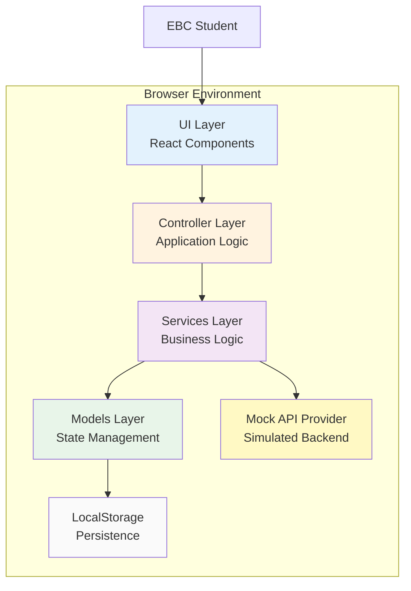
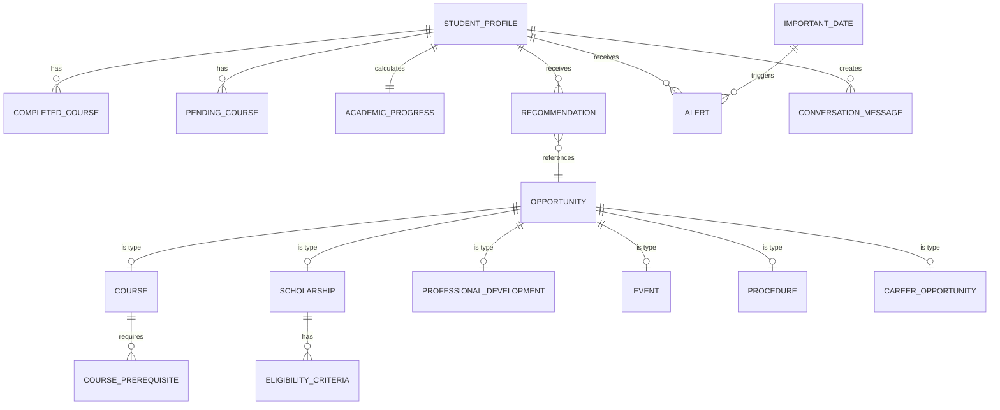

# Design Document: EBC Compass
## Personalized Academic and Professional Guidance System for Escuela Bancaria y Comercial

## 1. Introduction

### 1.1 Purpose

This design document specifies the architecture, components, interfaces, data models, and implementation strategy for **EBC Compass**—a personalized academic and professional guidance system for students at Escuela Bancaria y Comercial (EBC), a Mexican banking and commercial school. The system provides tailored recommendations for academic courses, scholarships, professional development opportunities, industry events, administrative procedures, and career opportunities in the banking, finance, marketing, and business administration sectors.

### 1.2 Scope

This design covers the MVP implementation using:
- **Client-side web application** (Single Page Application)
- **Mock REST API layer** (simulated backend responses)
- **Local storage persistence** (browser-based)
- **Spanish language primary** with English support
- **Six opportunity types**: Courses, Scholarships, Professional Development, Events, Procedures, Career Opportunities
- **Rule-based recommendation engine** (no machine learning in MVP)
- **Responsive design** (mobile-first: 320px-428px, tablet: 768px-1024px, desktop: 1280px+)

### 1.3 Design Goals

1. **Traceability**: Clear mapping between all functional/non-functional requirements (RF-01 to RF-06, NF-01 to NF-03, BR-01 to BR-05) and design components
2. **Simplicity**: Minimize complexity appropriate for MVP scope while maintaining extensibility
3. **Maintainability**: Clean separation of concerns, testable components, documented interfaces
4. **User-Centric**: Intuitive Spanish-language interface, mobile-optimized, accessibility-compliant
5. **Privacy-First**: Local storage only, minimal data collection, no external data transmission in MVP

### 1.4 Key Architectural Decisions

| Decision | Rationale | Tradeoffs | Future Migration Path |
|----------|-----------|-----------|----------------------|
| Client-side SPA | Simplifies MVP deployment, no backend infrastructure | Limited to browser capabilities | Add Node.js/Express backend |
| LocalStorage persistence | Native browser API, immediate availability | Data not shared across devices | Migrate to backend DB (PostgreSQL) |
| Mock data provider | Simulates backend, enables rapid prototyping | Must be replaced for production | Replace with REST API client |
| Rule-based recommendation | Simple, predictable, fast (<2s response) | Less sophisticated than ML | Upgrade to ML-based engine |
| Spanish primary language | Matches EBC's Mexican context | Requires translation management | Add i18n framework (react-i18next) |


## 2. Requirements Traceability Matrix

This section maps all requirements to design components, ensuring complete coverage.

### 2.1 Functional Requirements Mapping

| Requirement ID | Requirement Summary | Design Components | Data Models | Testing Strategy |
|---------------|---------------------|-------------------|-------------|------------------|
| **RF-01.1** | Capture student name | ProfileForm component | StudentProfile.name | Unit test |
| **RF-01.2** | Campus selection | ProfileForm component | StudentProfile.campus | Example test |
| **RF-01.3** | Career selection | ProfileForm component | StudentProfile.career | Example test |
| **RF-01.4** | Semester input (1-10) | ProfileForm component | StudentProfile.currentSemester | Property test (range validation) |
| **RF-01.5** | Add completed courses | CourseListInput component | StudentProfile.completedCourses | Property test |
| **RF-01.6** | Add pending courses | CourseListInput component | StudentProfile.pendingCourses | Property test |
| **RF-01.7** | Business/finance interests | InterestsInput component | StudentProfile.interests | Property test |
| **RF-01.8** | Professional goals | GoalsTextarea component | StudentProfile.goals | Property test |
| **RF-01.9** | Availability preferences | AvailabilitySelect component | StudentProfile.availability | Property test |
| **RF-01.10** | Save profile data | ProfileService.saveProfile | LocalStorage | Property test (round-trip) |
| **RF-01.11** | Edit profile data | ProfileForm component | StudentProfile | Property test |
| **RF-01.12** | Calculate completeness | ProfileService.calculateCompleteness | ProfileCompleteness | Property test |
| **RF-01.13** | Prompt if incomplete | ProfileCompletenessIndicator | UI state | Example test |
| **RF-02.1** | Display academic progress | AcademicProgressWidget | AcademicProgress | Example test |
| **RF-02.2** | Display semester | DashboardHeader | StudentProfile | Example test |
| **RF-02.3** | Recommended courses | RecommendationsWidget | Course[] | Example test |
| **RF-02.4** | Recommended procedures | RecommendationsWidget | Procedure[] | Example test |
| **RF-02.5** | Important dates | CalendarWidget | ImportantDate[] | Example test |
| **RF-02.6** | Opportunities feed | OpportunitiesFeed | Recommendation[] | Example test |
| **RF-02.7** | Refresh on profile update | RecommendationEngine | Event system | Property test |
| **RF-02.8** | Spanish primary language | i18n configuration | Language files | Example test |
| **RF-02.9** | Responsive mobile design | Responsive layouts | CSS breakpoints | Integration test |
| **RF-02.10** | Onboarding for new users | OnboardingFlow component | UI state | Example test |
| **RF-03.1** | Course recs by career | CourseRecommendationService | Course, Career | Property test |
| **RF-03.2** | Course recs by semester | CourseRecommendationService | Course, Semester | Property test |
| **RF-03.3** | Course recs by prerequisites | PrerequisiteValidator | Course graph | Property test |
| **RF-03.4** | Scholarship recs by eligibility | ScholarshipRecommendationService | Scholarship | Property test |
| **RF-03.5** | Prof dev recs | ProfDevRecommendationService | ProfessionalDevelopment | Property test |
| **RF-03.6** | Event recs | EventRecommendationService | Event | Property test |
| **RF-03.7** | Procedure recs | ProcedureRecommendationService | Procedure | Property test |
| **RF-03.8** | Career opportunity recs | CareerRecommendationService | CareerOpportunity | Property test |
| **RF-03.9** | Block courses without prerequisites | PrerequisiteValidator | Course graph | Property test |
| **RF-03.10** | Block ineligible scholarships | EligibilityValidator | Scholarship | Property test |
| **RF-03.11** | Prioritize by relevance | RecommendationRanker | Recommendation[] | Property test (sorting) |
| **RF-03.12** | Handle incomplete profiles | RecommendationEngine | Profile validation | Property test |
| **RF-03.13** | Update within 2 seconds | RecommendationEngine | Performance | Smoke test |
| **RF-04.1-06** | Calendar view of dates | CalendarComponent | ImportantDate[] | Example test |
| **RF-04.7** | Alert for 7-day deadlines | AlertService.generateAlerts | Alert | Property test |
| **RF-04.8** | Alert for enrollment | AlertService.generateAlerts | Alert | Example test |
| **RF-04.9** | Alert for scholarship deadlines | AlertService.generateAlerts | Alert | Property test |
| **RF-04.10** | Display alerts on dashboard | AlertWidget | Alert[] | Example test |
| **RF-04.11** | Dismiss alerts | AlertService.dismissAlert | Alert state | Property test |
| **RF-04.12** | Spanish calendar content | i18n | Language files | Example test |
| **RF-05.1** | Accept Spanish input | ConversationalAssistant | Query processing | Property test |
| **RF-05.2** | Accept English input | ConversationalAssistant | Query processing | Property test |
| **RF-05.3** | Respond in same language | LanguageDetector | Response generation | Property test |
| **RF-05.4** | Fuzzy keyword matching | KeywordMatcher | Matching algorithm | Property test |
| **RF-05.5** | Context-aware: Career | ContextEnricher | Profile context | Property test |
| **RF-05.6** | Context-aware: Semester | ContextEnricher | Profile context | Property test |
| **RF-05.7** | Context-aware: Courses | ContextEnricher | Profile context | Property test |
| **RF-05.8** | Explain prerequisites | QueryHandler | Course data | Property test |
| **RF-05.9** | Explain eligibility | QueryHandler | Scholarship data | Property test |
| **RF-05.10** | Explain procedures | QueryHandler | Procedure data | Property test |
| **RF-05.11** | Rule-based logic only | ConversationalAssistant | Architecture constraint | Integration test |
| **RF-05.12** | Respond within 2 seconds | ConversationalAssistant | Performance | Smoke test |
| **RF-05.13** | Suggest alternatives if no match | QueryHandler | Fallback logic | Example test |
| **RF-05.14** | Direct to EBC resources | QueryHandler | Fallback logic | Example test |
| **RF-06.1-06** | Catalog with 6 types | OpportunityCatalog | All opportunity types | Example test |
| **RF-06.7** | Filter by type | CatalogFilterService | Filter logic | Property test |
| **RF-06.8** | Filter by career | CatalogFilterService | Filter logic | Property test |
| **RF-06.9** | Filter by semester | CatalogFilterService | Filter logic | Property test |
| **RF-06.10** | Keyword search | CatalogSearchService | Search algorithm | Property test |
| **RF-06.11** | Spanish display | i18n | Language files | Example test |
| **RF-06.12** | Indicate recommended | OpportunityCard | UI state | Example test |
| **RF-06.13** | Display days remaining | DateFormatter | Date calculation | Property test |

### 2.2 Non-Functional Requirements Mapping

| Requirement ID | Requirement Summary | Design Components | Validation Method |
|---------------|---------------------|-------------------|-------------------|
| **NF-01.1** | 2-second response time | Performance optimization | Smoke test |
| **NF-01.2** | 3-second dashboard load (4G) | Asset optimization, code splitting | Smoke test |
| **NF-01.3** | Mobile 320px-428px rendering | Responsive CSS | Integration test (visual regression) |
| **NF-01.4** | Tablet 768px-1024px rendering | Responsive CSS | Integration test (visual regression) |
| **NF-01.5** | Desktop 1280px+ rendering | Responsive CSS | Integration test (visual regression) |
| **NF-01.6** | Mobile-first responsive design | CSS breakpoints, Tailwind utilities | Integration test |
| **NF-01.7** | Optimized assets | Image compression, lazy loading | Smoke test (bundle analysis) |
| **NF-02.1** | Spanish primary language | i18n configuration | Example test |
| **NF-02.2** | English secondary language | i18n configuration | Example test |
| **NF-02.3** | WCAG 2.1 Level AA | Accessibility patterns, ARIA | Integration test (axe-core) |
| **NF-02.4** | Keyboard navigation | Focus management | Integration test |
| **NF-02.5** | Alt text for images | Image components | Property test |
| **NF-02.6** | 4.5:1 color contrast | Color palette | Integration test (contrast checker) |
| **NF-02.7** | Visible focus indicators | CSS focus styles | Integration test |
| **NF-02.8** | Screen reader support | ARIA labels, semantic HTML | Integration test |
| **NF-03.1** | Minimal data collection | Privacy-by-design | Code review |
| **NF-03.2** | Secure storage | LocalStorage encryption (future) | Integration test |
| **NF-03.3** | No third-party sharing | No external API calls | Integration test (network monitor) |
| **NF-03.4** | Data export | ProfileService.exportData | Property test |
| **NF-03.5** | Data deletion | ProfileService.deleteData | Property test |
| **NF-03.6** | Privacy policy display | PrivacyPolicyModal | Example test |
| **NF-03.7** | Consent on profile creation | ConsentDialog | Example test |

### 2.3 Business Rules Mapping

| Rule ID | Rule Summary | Implementation | Testing Strategy |
|---------|--------------|----------------|------------------|
| **BR-01.1** | Prerequisite validation | PrerequisiteValidator.validate | Property test |
| **BR-01.2** | Semester-specific courses | SemesterFilter.filter | Property test |
| **BR-01.3** | No duplicate course recs | DuplicateFilter.filter | Property test |
| **BR-01.4** | Prioritize required courses | CourseRanker.rank | Property test |
| **BR-01.5** | Calculate prerequisite chains | PrerequisiteChainCalculator | Property test |
| **BR-02.1** | GPA requirements | GPA Validator | Property test |
| **BR-02.2** | Career-specific scholarships | CareerMatcher | Property test |
| **BR-02.3** | Semester requirements | SemesterMatcher | Property test |
| **BR-02.4** | Campus restrictions | CampusMatcher | Property test |
| **BR-02.5** | Deadline filtering | DeadlineFilter | Property test |
| **BR-03.1** | Progress calculation formula | ProgressCalculator | Property test |
| **BR-03.2** | Fallback semester-based progress | ProgressCalculator | Example test |
| **BR-03.3** | Display as percentage | ProgressFormatter | Property test |
| **BR-03.4** | Update on course change | Event system | Smoke test |
| **BR-03.5** | Expected graduation | GraduationCalculator | Property test |
| **BR-04.1** | 7-day normal alert | AlertGenerator | Property test |
| **BR-04.2** | 3-day high-priority alert | AlertGenerator | Property test |
| **BR-04.3** | 1-day urgent alert | AlertGenerator | Property test |
| **BR-04.4** | No duplicate alerts | AlertDeduplicator | Property test |
| **BR-04.5** | Dismissed alert logic | AlertService | Property test |
| **BR-04.6** | Max 5 concurrent alerts | AlertLimiter | Property test |
| **BR-05.1** | Required fields | ProfileValidator | Example test |
| **BR-05.2** | Completeness calculation | CompletenessCalculator | Property test |
| **BR-05.3** | Display missing fields | ProfileCompletenessIndicator | Property test |
| **BR-05.4** | Enable full recs at 100% | Feature gating | Example test |
| **BR-05.5** | Optional fields | ProfileValidator | Example test |


## 3. System Architecture

### 3.1 High-Level Architecture



**Layer Responsibilities:**

1. **UI Layer** (View)
   - React components for all visual elements
   - User interaction handling
   - No business logic
   - Validates: RF-01, RF-02, RF-04.10, RF-06

2. **Controller Layer** (Application Logic)
   - Routing and navigation
   - Component lifecycle management
   - Event orchestration
   - Validates: RF-02.7, NF-01

3. **Services Layer** (Business Logic)
   - Recommendation engine
   - Eligibility validation
   - Keyword matching
   - Alert generation
   - Validates: RF-03, RF-04.7-09, RF-05, BR-01 through BR-05

4. **Models Layer** (State Management)
   - Application state
   - Data validation
   - Persistence operations
   - Validates: RF-01.10-11, NF-03

5. **Mock API Provider** (Simulated Backend)
   - Returns predefined personas and opportunities
   - Simulates async operations (200ms delay)
   - Validates: Mock data requirements

### 3.2 Technology Stack

**Frontend Framework:** React 18+ with TypeScript 5+
- **Rationale:** Component model, strong typing, large ecosystem, excellent dev tools
- **Alternatives:** Vue 3 (similar capabilities), Svelte (smaller bundle)

**State Management:** React Context API + useReducer
- **Rationale:** Sufficient for MVP, no external dependencies, built-in
- **Alternatives:** Redux Toolkit (more complex state), Zustand (lighter weight)

**Styling:** Tailwind CSS 3+
- **Rationale:** Utility-first, responsive utilities, mobile-first, tree-shakeable
- **Alternatives:** CSS Modules, Styled Components, MUI

**Build Tool:** Vite 5+
- **Rationale:** Fast dev server, HMR, optimized builds, ESM-based
- **Alternatives:** Create React App (slower), Next.js (overkill for SPA)

**Testing:**
- **Unit/Component:** Vitest + React Testing Library
- **Property-Based:** fast-check (TypeScript native, comprehensive generators)
- **E2E:** Playwright (cross-browser, reliable)
- **Accessibility:** axe-core (WCAG compliance checking)

**Date Handling:** date-fns
- **Rationale:** Lightweight, tree-shakeable, immutable, Spanish locale support
- **Alternatives:** Day.js, Luxon

**Internationalization:** react-i18next
- **Rationale:** Industry standard, namespace support, lazy loading
- **Alternatives:** react-intl, Format.JS


## 4. Data Model

### 4.1 Entity-Relationship Diagram



### 4.2 Core Data Entities

#### 4.2.1 StudentProfile

```typescript
interface StudentProfile {
  id: string;  // UUID
  name: string;  // RF-01.1
  campus: Campus;  // RF-01.2
  career: Career;  // RF-01.3
  currentSemester: number;  // 1-10, RF-01.4
  completedCourses: CompletedCourse[];  // RF-01.5
  pendingCourses: PendingCourse[];  // RF-01.6
  interests: string[];  // RF-01.7
  goals: string;  // RF-01.8
  availability: string[];  // RF-01.9
  gpa?: number;  // Optional, for scholarship matching
  createdAt: Date;
  updatedAt: Date;
}

enum Campus {
  CIUDAD_DE_MEXICO = "ciudad-de-mexico",
  GUADALAJARA = "guadalajara",
  MONTERREY = "monterrey",
  QUERETARO = "queretaro",
  PUEBLA = "puebla",
  TIJUANA = "tijuana"
}

enum Career {
  BANKING = "banking",  // Banca y Finanzas
  FINANCE = "finance",  // Finanzas
  MARKETING = "marketing",  // Mercadotecnia
  BUSINESS_ADMIN = "business-administration"  // Administración de Empresas
}

interface CompletedCourse {
  courseCode: string;  // e.g., "FIN-101"
  courseName: string;  // e.g., "Fundamentos de Finanzas"
  semester: number;  // When completed
  grade?: string;  // Optional
}

interface PendingCourse {
  courseCode: string;
  courseName: string;
}
```

**Storage:** LocalStorage key `ebc_compass_profile`  
**Validation Rules:**
- name: 1-100 characters
- currentSemester: integer 1-10
- completedCourses: array, 0-50 items
- interests: array, 0-10 items, each 1-50 chars
- goals: 0-500 characters

**Validates:** RF-01 (all acceptance criteria)

#### 4.2.2 AcademicProgress

```typescript
interface AcademicProgress {
  profileId: string;
  completedCount: number;  // Number of completed courses
  totalRequired: number;  // Total courses required for career (career-specific)
  percentage: number;  // (completedCount / totalRequired) × 100
  expectedGraduation: string;  // "2025-06" (YYYY-MM format)
  onTrack: boolean;  // Whether student is on track for expected graduation
}
```

**Calculation Logic:**
```typescript
function calculateProgress(profile: StudentProfile): AcademicProgress {
  const totalRequired = CAREER_TOTAL_COURSES[profile.career]; // e.g., 40 courses
  const completedCount = profile.completedCourses.length;
  const percentage = (completedCount / totalRequired) * 100;
  
  // Expected graduation based on current semester and progress
  const semestersRemaining = Math.ceil((totalRequired - completedCount) / 5); // Assume 5 courses/semester
  const expectedSemester = profile.currentSemester + semestersRemaining;
  const expectedYear = Math.floor(2024 + expectedSemester / 2);
  const expectedMonth = (expectedSemester % 2 === 0) ? "06" : "12";
  
  return {
    profileId: profile.id,
    completedCount,
    totalRequired,
    percentage: Math.min(percentage, 100),
    expectedGraduation: `${expectedYear}-${expectedMonth}`,
    onTrack: semestersRemaining <= (10 - profile.currentSemester)
  };
}
```

**Validates:** RF-02.1, BR-03 (all)

#### 4.2.3 Opportunity (Base Type)

```typescript
type OpportunityType = "course" | "scholarship" | "professional-development" | "event" | "procedure" | "career-opportunity";

interface Opportunity {
  id: string;
  type: OpportunityType;
  title: string;
  description: string;
  career?: Career;  // Career relevance
  semester?: number[];  // Applicable semesters
  tags: string[];  // Keywords for matching
  createdAt: Date;
}
```

#### 4.2.4 Course

```typescript
interface Course extends Opportunity {
  type: "course";
  courseCode: string;  // e.g., "FIN-201"
  credits: number;
  prerequisites: string[];  // Course codes
  corequisites?: string[];  // Courses that must be taken simultaneously
  semesterOffered: number[];  // Which semesters this course is offered (e.g., [1,2,5,6])
  campus: Campus[];  // Which campuses offer this course
  required: boolean;  // Required for career or elective
}
```

**Validates:** RF-06.1, BR-01

#### 4.2.5 Scholarship

```typescript
interface Scholarship extends Opportunity {
  type: "scholarship";
  amount: number;  // Award amount in MXN
  deadline: Date;  // Application deadline
  eligibilityCriteria: EligibilityCriteria;
  applicationLink: string;
  provider: string;  // e.g., "EBC Foundation", "Santander Scholarships"
}

interface EligibilityCriteria {
  minGPA?: number;  // e.g., 8.5
  careers?: Career[];  // Specific careers eligible
  semesters?: number[];  // Specific semesters eligible (e.g., [3,4,5,6])
  campuses?: Campus[];  // Campus restrictions
  requirements?: string[];  // Additional requirements (e.g., "Leadership experience")
}
```

**Validates:** RF-06.2, BR-02

#### 4.2.6 ProfessionalDevelopment

```typescript
interface ProfessionalDevelopment extends Opportunity {
  type: "professional-development";
  provider: string;  // e.g., "AMIB", "Bloomberg", "EBC Training Center"
  certification?: string;  // e.g., "Bloomberg Market Concepts"
  duration: string;  // e.g., "4 semanas", "20 horas"
  format: "online" | "presencial" | "híbrido";
  cost?: number;  // Cost in MXN, or 0 for free
  registrationLink: string;
  startDate?: Date;
}
```

**Validates:** RF-06.3

#### 4.2.7 Event

```typescript
interface Event extends Opportunity {
  type: "event";
  date: Date;
  time: string;  // e.g., "14:00"
  location: string;  // e.g., "Campus Ciudad de México, Auditorio Principal"
  eventType: "conference" | "career-fair" | "networking" | "workshop" | "guest-speaker";
  registrationRequired: boolean;
  registrationLink?: string;
  capacity?: number;
  organizer: string;
}
```

**Validates:** RF-06.4

#### 4.2.8 Procedure

```typescript
interface Procedure extends Opportunity {
  type: "procedure";
  deadline?: Date;  // If time-sensitive
  steps: ProcedureStep[];
  requiredDocuments: string[];  // e.g., ["INE", "Comprobante de domicilio"]
  processingTime: string;  // e.g., "5 días hábiles"
  office: string;  // e.g., "Servicios Escolares"
  onlineAvailable: boolean;
  procedureLink?: string;
}

interface ProcedureStep {
  stepNumber: number;
  description: string;
  estimatedTime?: string;
}
```

**Validates:** RF-06.5

#### 4.2.9 CareerOpportunity

```typescript
interface CareerOpportunity extends Opportunity {
  type: "career-opportunity";
  employer: string;  // e.g., "BBVA Bancomer", "Citibanamex"
  position: string;  // e.g., "Practicante de Análisis Financiero"
  opportunityType: "internship" | "entry-level" | "part-time";
  location: string;
  salary?: string;  // e.g., "$8,000 - $12,000 MXN/mes"
  requirements: string[];  // e.g., ["Semester 5+", "Excel advanced"]
  applicationLink: string;
  deadline?: Date;
}
```

**Validates:** RF-06.6

#### 4.2.10 Recommendation

```typescript
interface Recommendation {
  id: string;
  profileId: string;
  opportunity: Opportunity;  // Full opportunity object
  relevanceScore: number;  // 0-100
  explanation: string;  // Why this was recommended (RF-05, BR-03)
  generatedAt: Date;
  dismissed: boolean;
}
```

**Explanation Generation Logic:**
```typescript
function generateExplanation(
  opportunity: Opportunity,
  profile: StudentProfile,
  matchedFactors: MatchedFactor[]
): string {
  const factors: string[] = [];
  
  // Check matched interests
  const matchedInterests = matchedFactors
    .filter(f => f.type === "interest")
    .map(f => f.value);
  if (matchedInterests.length > 0) {
    factors.push(`tu interés en ${matchedInterests.join(" y ")}`);
  }
  
  // Check career match
  if (matchedFactors.some(f => f.type === "career")) {
    factors.push(`tu carrera de ${CAREER_NAMES_ES[profile.career]}`);
  }
  
  // Check semester appropriateness
  if (matchedFactors.some(f => f.type === "semester")) {
    factors.push(`tu semestre actual (${profile.currentSemester})`);
  }
  
  const factorsText = factors.join(", ");
  const typeText = OPPORTUNITY_TYPE_NAMES_ES[opportunity.type];
  
  return `Esta ${typeText} coincide con ${factorsText}.`;
}
```

**Validates:** RF-03, RF-04

#### 4.2.11 ImportantDate

```typescript
interface ImportantDate {
  id: string;
  type: "enrollment" | "exam" | "deadline" | "holiday" | "event";
  title: string;
  date: Date;
  description: string;
  relatedTo?: string;  // e.g., opportunity ID for scholarship deadline
}
```

**Validates:** RF-04.1-06

#### 4.2.12 Alert

```typescript
interface Alert {
  id: string;
  profileId: string;
  urgency: "normal" | "high" | "urgent";  // BR-04.1-3
  title: string;
  message: string;
  relatedDate: Date;
  daysRemaining: number;
  dismissed: boolean;
  dismissedAt?: Date;
  createdAt: Date;
}
```

**Alert Generation Logic:**
```typescript
function generateAlerts(profile: StudentProfile, dates: ImportantDate[]): Alert[] {
  const today = new Date();
  const alerts: Alert[] = [];
  
  dates.forEach(date => {
    const daysRemaining = Math.floor((date.date.getTime() - today.getTime()) / (1000 * 60 * 60 * 24));
    
    if (daysRemaining >= 1 && daysRemaining <= 7) {
      let urgency: Alert["urgency"] = "normal";
      if (daysRemaining <= 1) urgency = "urgent";  // BR-04.3
      else if (daysRemaining <= 3) urgency = "high";  // BR-04.2
      
      alerts.push({
        id: generateUUID(),
        profileId: profile.id,
        urgency,
        title: date.title,
        message: `Quedan ${daysRemaining} día(s) para ${date.title}`,
        relatedDate: date.date,
        daysRemaining,
        dismissed: false,
        createdAt: today
      });
    }
  });
  
  // Deduplicate (BR-04.4)
  const uniqueAlerts = deduplicateAlerts(alerts);
  
  // Limit to 5 (BR-04.6)
  return uniqueAlerts
    .sort((a, b) => a.daysRemaining - b.daysRemaining)  // Most urgent first
    .slice(0, 5);
}
```

**Validates:** RF-04.7-11, BR-04

#### 4.2.13 ConversationMessage

```typescript
interface ConversationMessage {
  id: string;
  profileId: string;
  role: "student" | "assistant";
  content: string;
  language: "es" | "en";  // RF-05.3
  timestamp: Date;
}
```

**Validates:** RF-05


## 5. Main Components

### 5.1 Component Hierarchy

```
App
├── Header
│   ├── Logo
│   ├── LanguageToggle (ES/EN)
│   └── NavigationMenu
├── Router
│   ├── DashboardPage
│   │   ├── ProfileSidebar
│   │   │   ├── ProfileCompletenessIndicator
│   │   │   ├── ProfileSummaryCard
│   │   │   └── EditProfileButton
│   │   ├── MainDashboard
│   │   │   ├── WelcomeHeader
│   │   │   ├── AcademicProgressWidget
│   │   │   ├── AlertsWidget
│   │   │   ├── RecommendationsWidget
│   │   │   │   └── RecommendationCard[]
│   │   │   └── UpcomingDatesWidget
│   │   └── QuickActionsPanel
│   ├── ProfileEditPage
│   │   ├── ProfileForm
│   │   │   ├── TextInput (name)
│   │   │   ├── SelectInput (campus, career)
│   │   │   ├── NumberInput (semester)
│   │   │   ├── CourseListInput (completed, pending)
│   │   │   ├── TagsInput (interests)
│   │   │   ├── TextareaInput (goals)
│   │   │   └── CheckboxGroup (availability)
│   │   └── PersonaSelector
│   ├── OpportunitiesCatalogPage
│   │   ├── FilterSidebar
│   │   │   ├── TypeFilter
│   │   │   ├── CareerFilter
│   │   │   └── SemesterFilter
│   │   ├── SearchBar
│   │   └── OpportunityGrid
│   │       └── OpportunityCard[]
│   ├── CalendarPage
│   │   ├── MonthView
│   │   ├── ImportantDatesList
│   │   └── AlertsPanel
│   └── ChatPage
│       ├── ConversationHistory
│       │   ├── StudentMessage[]
│       │   └── AssistantMessage[]
│       ├── QueryInput
│       └── SuggestedQuestions
└── Footer
    ├── PrivacyLink
    └── ContactInfo
```

### 5.2 Key Component Specifications

#### 5.2.1 ProfileForm Component

**Purpose:** Capture and edit student profile information

**Props:**
```typescript
interface ProfileFormProps {
  initialProfile?: StudentProfile;
  onSave: (profile: StudentProfile) => Promise<void>;
  onCancel: () => void;
}
```

**Validation Rules:**
- Name: Required, 1-100 characters
- Campus: Required, must be valid enum
- Career: Required, must be valid enum
- Semester: Required, integer 1-10
- Completed courses: Optional, each course must have code and name
- Interests: Optional, 0-10 items, each 1-50 characters
- Goals: Optional, 0-500 characters

**Validates:** RF-01 (all)

#### 5.2.2 AcademicProgressWidget Component

**Purpose:** Display student's academic progress visually

**Props:**
```typescript
interface AcademicProgressWidgetProps {
  progress: AcademicProgress;
}
```

**Visual Design:**
- Circular progress chart showing percentage complete
- Completed vs. total courses (e.g., "24/40 cursos completados")
- Expected graduation date
- "On track" indicator (green check or yellow warning)
- Spanish labels

**Validates:** RF-02.1, BR-03

#### 5.2.3 RecommendationCard Component

**Purpose:** Display a single recommendation with relevance explanation

**Props:**
```typescript
interface RecommendationCardProps {
  recommendation: Recommendation;
  onDismiss?: (id: string) => void;
  onViewDetails?: (id: string) => void;
}
```

**Visual Elements:**
- Opportunity type badge (color-coded)
- Title and description
- Relevance explanation
- Date/deadline (if applicable)
- Call-to-action button ("Ver detalles", "Inscribirse", "Solicitar")

**Validates:** RF-02.6, RF-03, RF-06.12

#### 5.2.4 ConversationalAssistant Component

**Purpose:** Bilingual chatbot interface

**Props:**
```typescript
interface ConversationalAssistantProps {
  profile: StudentProfile;
  onNewMessage: (message: ConversationMessage) => void;
}
```

**Features:**
- Language detection (Spanish/English)
- Fuzzy keyword matching
- Context injection (profile data)
- Response templates
- Fallback suggestions

**Validates:** RF-05 (all)

#### 5.2.5 AlertWidget Component

**Purpose:** Display urgent/important alerts

**Props:**
```typescript
interface AlertWidgetProps {
  alerts: Alert[];
  onDismiss: (alertId: string) => void;
}
```

**Visual Design:**
- Color-coded by urgency: normal (blue), high (orange), urgent (red)
- Days remaining prominently displayed
- Dismissible (X button)
- Maximum 5 concurrent alerts
- Spanish text

**Validates:** RF-04.7-11, BR-04.6

### 5.3 Service Layer Components

#### 5.3.1 RecommendationEngine Service

**Core Algorithm:**

```typescript
class RecommendationEngine {
  generateRecommendations(
    profile: StudentProfile,
    opportunities: Opportunity[]
  ): Recommendation[] {
    const recommendations: Recommendation[] = [];
    
    // Filter opportunities by type and apply type-specific logic
    const courses = opportunities.filter(o => o.type === "course") as Course[];
    const scholarships = opportunities.filter(o => o.type === "scholarship") as Scholarship[];
    const profDev = opportunities.filter(o => o.type === "professional-development");
    const events = opportunities.filter(o => o.type === "event");
    const procedures = opportunities.filter(o => o.type === "procedure");
    const careers = opportunities.filter(o => o.type === "career-opportunity");
    
    // Generate course recommendations
    recommendations.push(...this.recommendCourses(profile, courses));
    
    // Generate scholarship recommendations
    recommendations.push(...this.recommendScholarships(profile, scholarships));
    
    // Generate professional development recommendations
    recommendations.push(...this.recommendProfDev(profile, profDev));
    
    // Generate event recommendations
    recommendations.push(...this.recommendEvents(profile, events));
    
    // Generate procedure recommendations
    recommendations.push(...this.recommendProcedures(profile, procedures));
    
    // Generate career opportunity recommendations
    recommendations.push(...this.recommendCareers(profile, careers));
    
    // Rank and return top recommendations
    return this.rankRecommendations(recommendations).slice(0, 10);
  }
  
  private recommendCourses(profile: StudentProfile, courses: Course[]): Recommendation[] {
    return courses
      .filter(course => {
        // BR-01.1: Check prerequisites
        const prerequisitesMet = course.prerequisites.every(prereq =>
          profile.completedCourses.some(cc => cc.courseCode === prereq)
        );
        if (!prerequisitesMet) return false;
        
        // BR-01.2: Check semester offering
        if (!course.semesterOffered.includes(profile.currentSemester)) return false;
        
        // BR-01.3: No duplicates
        if (profile.completedCourses.some(cc => cc.courseCode === course.courseCode)) return false;
        
        // Check career relevance
        if (course.career && course.career !== profile.career) return false;
        
        // Check campus availability
        if (!course.campus.includes(profile.campus)) return false;
        
        return true;
      })
      .map(course => {
        const score = this.calculateCourseScore(course, profile);
        const explanation = this.generateCourseExplanation(course, profile);
        
        return {
          id: generateUUID(),
          profileId: profile.id,
          opportunity: course,
          relevanceScore: score,
          explanation,
          generatedAt: new Date(),
          dismissed: false
        };
      });
  }
  
  private calculateCourseScore(course: Course, profile: StudentProfile): number {
    let score = 0;
    
    // BR-01.4: Required courses get higher priority
    if (course.required) score += 50;
    
    // Career match
    if (course.career === profile.career) score += 30;
    
    // Interest match
    const matchedInterests = course.tags.filter(tag =>
      profile.interests.some(interest =>
        interest.toLowerCase().includes(tag.toLowerCase())
      )
    );
    score += matchedInterests.length * 10;
    
    // Semester appropriateness (prefer earlier semesters)
    if (course.semesterOffered.includes(profile.currentSemester)) score += 20;
    
    return Math.min(score, 100);
  }
  
  private recommendScholarships(profile: StudentProfile, scholarships: Scholarship[]): Recommendation[] {
    return scholarships
      .filter(scholarship => {
        const criteria = scholarship.eligibilityCriteria;
        
        // BR-02.1: GPA requirement
        if (criteria.minGPA && profile.gpa && profile.gpa < criteria.minGPA) return false;
        
        // BR-02.2: Career-specific
        if (criteria.careers && !criteria.careers.includes(profile.career)) return false;
        
        // BR-02.3: Semester requirements
        if (criteria.semesters && !criteria.semesters.includes(profile.currentSemester)) return false;
        
        // BR-02.4: Campus restrictions
        if (criteria.campuses && !criteria.campuses.includes(profile.campus)) return false;
        
        // BR-02.5: Deadline not passed
        if (scholarship.deadline < new Date()) return false;
        
        return true;
      })
      .map(scholarship => ({
        id: generateUUID(),
        profileId: profile.id,
        opportunity: scholarship,
        relevanceScore: this.calculateScholarshipScore(scholarship, profile),
        explanation: this.generateScholarshipExplanation(scholarship, profile),
        generatedAt: new Date(),
        dismissed: false
      }));
  }
  
  private rankRecommendations(recommendations: Recommendation[]): Recommendation[] {
    // Sort by relevance score descending, then by date ascending
    return recommendations.sort((a, b) => {
      if (b.relevanceScore !== a.relevanceScore) {
        return b.relevanceScore - a.relevanceScore;
      }
      
      // For opportunities with dates, sort by date
      const aDate = (a.opportunity as any).date || (a.opportunity as any).deadline;
      const bDate = (b.opportunity as any).date || (b.opportunity as any).deadline;
      
      if (aDate && bDate) {
        return aDate.getTime() - bDate.getTime();
      }
      
      return 0;
    });
  }
}
```

**Validates:** RF-03 (all), BR-01, BR-02

#### 5.3.2 PrerequisiteValidator Service

**Purpose:** Validate course prerequisite chains

```typescript
class PrerequisiteValidator {
  validate(course: Course, completedCourses: CompletedCourse[]): {
    valid: boolean;
    missingPrerequisites: string[];
  } {
    const completedCodes = new Set(completedCourses.map(c => c.courseCode));
    const missing: string[] = [];
    
    for (const prereq of course.prerequisites) {
      if (!completedCodes.has(prereq)) {
        missing.push(prereq);
      }
    }
    
    return {
      valid: missing.length === 0,
      missingPrerequisites: missing
    };
  }
  
  // BR-01.5: Calculate optimal course sequence
  calculatePrerequisiteChain(
    targetCourse: Course,
    allCourses: Course[],
    completedCourses: CompletedCourse[]
  ): Course[] {
    const completedCodes = new Set(completedCourses.map(c => c.courseCode));
    const chain: Course[] = [];
    const toProcess = [targetCourse];
    const processed = new Set<string>();
    
    while (toProcess.length > 0) {
      const current = toProcess.pop()!;
      if (processed.has(current.courseCode)) continue;
      processed.add(current.courseCode);
      
      for (const prereqCode of current.prerequisites) {
        if (!completedCodes.has(prereqCode)) {
          const prereqCourse = allCourses.find(c => c.courseCode === prereqCode);
          if (prereqCourse) {
            chain.unshift(prereqCourse);
            toProcess.push(prereqCourse);
          }
        }
      }
    }
    
    chain.push(targetCourse);
    return chain;
  }
}
```

**Validates:** BR-01.1, BR-01.5

#### 5.3.3 ConversationalAssistant Service

**Purpose:** Process queries and generate context-aware responses

```typescript
class ConversationalAssistant {
  private keywordMatcher: KeywordMatcher;
  private contextEnricher: ContextEnricher;
  
  async processQuery(
    query: string,
    profile: StudentProfile,
    opportunities: Opportunity[]
  ): Promise<ConversationMessage> {
    // RF-05.4: Fuzzy keyword matching
    const keywords = this.keywordMatcher.extractKeywords(query);
    const language = this.detectLanguage(query);  // RF-05.3
    
    // Match query against known intents
    const intent = this.matchIntent(keywords, language);
    
    let response: string;
    
    if (intent.type === "course-info") {
      // RF-05.8: Explain prerequisites
      response = this.explainCoursePrerequisites(intent.courseCode, opportunities, language);
    } else if (intent.type === "scholarship-info") {
      // RF-05.9: Explain eligibility
      response = this.explainScholarshipEligibility(intent.scholarshipId, opportunities, profile, language);
    } else if (intent.type === "procedure-info") {
      // RF-05.10: Explain procedures
      response = this.explainProcedure(intent.procedureId, opportunities, language);
    } else if (intent.type === "recommendation-request") {
      // Generate recommendations
      const recs = this.recommendationEngine.generateRecommendations(profile, opportunities);
      response = this.formatRecommendations(recs, language);
    } else {
      // RF-05.13-14: Fallback
      response = this.generateFallbackResponse(keywords, language);
    }
    
    // RF-05.5-7: Context enrichment
    response = this.contextEnricher.enrich(response, profile);
    
    return {
      id: generateUUID(),
      profileId: profile.id,
      role: "assistant",
      content: response,
      language,
      timestamp: new Date()
    };
  }
  
  private detectLanguage(query: string): "es" | "en" {
    // Simple language detection based on common words
    const spanishIndicators = ["que", "como", "cuando", "donde", "porque", "para", "con"];
    const englishIndicators = ["what", "how", "when", "where", "why", "for", "with"];
    
    const lowerQuery = query.toLowerCase();
    const spanishScore = spanishIndicators.filter(word => lowerQuery.includes(word)).length;
    const englishScore = englishIndicators.filter(word => lowerQuery.includes(word)).length;
    
    return spanishScore >= englishScore ? "es" : "en";
  }
}
```

**Validates:** RF-05 (all)


## 6. UI/UX Design

### 6.1 Main Screens

#### 6.1.1 Dashboard Screen (Desktop 1280px+)

```
+----------------------------------------------------------------------+
| EBC Compass [Logo]                                    [ES] [Profile] |
+----------------------------------------------------------------------+
|                                                                      |
| +------------------+  +------------------------------------------+   |
| | PERFIL           |  | Bienvenido, [Name]                       |   |
| |                  |  | Semestre [X] | [Career]                  |   |
| | Completitud: 85% |  +------------------------------------------+   |
| | [Progress Bar]   |  |                                          |   |
| |                  |  | PROGRESO ACADÉMICO                       |   |
| | [Campus]         |  | [Circular Chart: 60% complete]           |   |
| | [Career]         |  | 24/40 cursos | Graduación: Jun 2025     |   |
| | Semestre: [X]    |  +------------------------------------------+   |
| |                  |  |                                          |   |
| | [Editar Perfil]  |  | ALERTAS                                  |   |
| +------------------+  | [!] Inscripciones abren en 3 días       |   |
|                       | [!] Fecha límite beca: 5 días           |   |
|                       +------------------------------------------+   |
|                       |                                          |   |
|                       | RECOMENDACIONES PARA TI                  |   |
|                       | +--------------------------------------+ |   |
|                       | | CURSO: Análisis Financiero Avanzado | |   |
|                       | | FIN-301 | Semestre 6 | 6 créditos   | |   |
|                       | | Esta materia coincide con tu carrera | |   |
|                       | | de Finanzas y tu interés en análisis.| |   |
|                       | | [Ver Detalles]                       | |   |
|                       | +--------------------------------------+ |   |
|                       | +--------------------------------------+ |   |
|                       | | BECA: Santander Becas Iberoamérica  | |   |
|                       | | $50,000 MXN | Fecha límite: 15/04   | |   |
|                       | | Cumples con los requisitos de GPA.   | |   |
|                       | | [Solicitar]                          | |   |
|                       | +--------------------------------------+ |   |
|                       |                                          |   |
+----------------------------------------------------------------------+
| © 2024 Escuela Bancaria y Comercial | Privacidad                    |
+----------------------------------------------------------------------+
```

#### 6.1.2 Dashboard Screen (Mobile 320px-428px)

```
+---------------------------+
| EBC [≡]            [ES] [👤]|
+---------------------------+
| Bienvenido, [Name]        |
| Semestre [X]              |
+---------------------------+
| PROGRESO                  |
| [Circle: 60%]             |
| 24/40 cursos completados  |
| Graduación: Jun 2025      |
+---------------------------+
| ALERTAS                   |
| [!] Inscripciones: 3 días |
| [!] Beca límite: 5 días   |
| [Ver todas]               |
+---------------------------+
| RECOMENDACIONES           |
| +------------------------+|
| | Análisis Financiero    ||
| | Avanzado               ||
| | FIN-301 | Sem 6        ||
| | [Ver]                  ||
| +------------------------+|
| +------------------------+|
| | Beca Santander         ||
| | $50,000 MXN            ||
| | Fecha: 15/04           ||
| | [Solicitar]            ||
| +------------------------+|
| [Ver más]                |
+---------------------------+
| [Inicio] [Catálogo] [Chat]|
+---------------------------+
```

#### 6.1.3 Opportunities Catalog Screen

```
+----------------------------------------------------------------------+
| Catálogo de Oportunidades                                            |
+----------------------------------------------------------------------+
| +----------------+  +--------------------------------------------+   |
| | FILTROS        |  | Búsqueda: [_____________________] [Buscar] |   |
| |                |  |                                            |   |
| | Tipo:          |  | Resultados: 24 oportunidades               |   |
| | [ ] Cursos     |  |                                            |   |
| | [ ] Becas      |  | +----------------------------------------+ |   |
| | [ ] Desarrollo |  | | CURSO: Marketing Digital               | |   |
| | [ ] Eventos    |  | | MKT-205 | 4 créditos                  | |   |
| | [ ] Trámites   |  | | Semestres: 5, 6 | Campus: CDMX       | |   |
| | [ ] Empleos    |  | | [Recomendado para ti]                | |   |
| |                |  | | [Ver Detalles]                       | |   |
| | Carrera:       |  | +----------------------------------------+ |   |
| | [ ] Banca      |  | +----------------------------------------+ |   |
| | [ ] Finanzas   |  | | BECA: Fundación EBC                  | |   |
| | [ ] Marketing  |  | | $30,000 MXN | Plazo: 20/05/2024     | |   |
| | [ ] Admin      |  | | Requisitos: GPA 8.5+, Sem 3-6        | |   |
| |                |  | | [Ver Detalles] [Solicitar]           | |   |
| | Semestre:      |  | +----------------------------------------+ |   |
| | [Slider 1-10]  |  | ...                                      |   |
| +----------------+  +--------------------------------------------+   |
+----------------------------------------------------------------------+
```

#### 6.1.4 Conversational Assistant Screen

```
+----------------------------------------------------------------------+
| Asistente Virtual                                              [X]   |
+----------------------------------------------------------------------+
| | Estudiante: ¿Qué becas están disponibles para Finanzas?          | |
| | 14:25                                                             | |
| +-------------------------------------------------------------------+ |
|                                                                     | |
| +-------------------------------------------------------------------+ |
| | Asistente: Encontré 3 becas disponibles para tu carrera:         | |
| |                                                                   | |
| | 1. Santander Becas Iberoamérica ($50,000 MXN)                    | |
| |    - Requisitos: GPA 8.0+, Semestre 4+                           | |
| |    - Fecha límite: 15/04/2024                                    | |
| |                                                                   | |
| | 2. Fundación EBC Excellence ($30,000 MXN)                        | |
| |    - Requisitos: GPA 8.5+, Semestre 3-6                          | |
| |    - Fecha límite: 20/05/2024                                    | |
| |                                                                   | |
| | 3. BBVA Scholarship for Finance Students ($25,000 MXN)           | |
| |    - Requisitos: Finanzas, Semestre 5+, Liderazgo               | |
| |    - Fecha límite: 30/06/2024                                    | |
| |                                                                   | |
| | ¿Necesitas más información sobre alguna de ellas?                | |
| | 14:25                                                             | |
| +-------------------------------------------------------------------+ |
|                                                                       |
| [Escribe tu pregunta...]                                  [Enviar]   |
+----------------------------------------------------------------------+
```

### 6.2 Responsive Breakpoints

| Breakpoint | Range | Layout Strategy |
|------------|-------|-----------------|
| **Mobile** | 320px - 767px | Single column, stacked components, bottom navigation, collapsible sections |
| **Tablet** | 768px - 1023px | Two-column where appropriate, sidebar for filters, top navigation |
| **Desktop** | 1024px - 1279px | Full two-column layout, persistent sidebars, hover interactions |
| **Large Desktop** | 1280px+ | Max content width 1440px, centered, enhanced spacing |

**Mobile-First CSS Strategy:**
```css
/* Base styles for mobile (320px) */
.dashboard-grid {
  display: flex;
  flex-direction: column;
  gap: 16px;
}

/* Tablet (768px+) */
@media (min-width: 768px) {
  .dashboard-grid {
    grid-template-columns: 300px 1fr;
    gap: 24px;
  }
}

/* Desktop (1024px+) */
@media (min-width: 1024px) {
  .dashboard-grid {
    grid-template-columns: 280px 1fr 320px;
    gap: 32px;
  }
}

/* Large Desktop (1280px+) */
@media (min-width: 1280px) {
  .container {
    max-width: 1440px;
    margin: 0 auto;
  }
}
```

**Validates:** NF-01.3-6

### 6.3 Visual Design System

#### 6.3.1 Color Palette

**Primary Colors:**
- Primary Blue: #0052CC (EBC brand color, buttons, links)
- Primary Dark: #003D99 (hover states)
- Primary Light: #E6F0FF (backgrounds, highlights)

**Secondary Colors:**
- Banking Green: #00875A (success, positive indicators)
- Finance Gold: #FF991F (accent, highlights)
- Alert Red: #DE350B (urgent, errors)
- Alert Orange: #FF8B00 (warnings, medium priority)

**Neutral Colors:**
- Text Primary: #172B4D (main text)
- Text Secondary: #5E6C84 (secondary text)
- Background: #FFFFFF (main background)
- Surface: #F4F5F7 (cards, sections)
- Border: #DFE1E6 (dividers)

**Semantic Colors:**
- Success: #00875A (> 80% complete, approved)
- Warning: #FF8B00 (50-80% complete, attention needed)
- Error: #DE350B (< 50% complete, missing requirements)
- Info: #0065FF (informational, tips)

**Contrast Ratios (WCAG 2.1 AA):**
- Text Primary on Background: 12.8:1 (AAA)
- Text Secondary on Background: 5.2:1 (AA)
- Primary Blue on Background: 7.5:1 (AAA)
- All interactive elements: ≥ 4.5:1 (AA)

**Validates:** NF-02.6

#### 6.3.2 Typography

**Font Stack:**
```css
--font-primary: 'Inter', -apple-system, BlinkMacSystemFont, 'Segoe UI', sans-serif;
--font-heading: 'Inter', -apple-system, BlinkMacSystemFont, 'Segoe UI', sans-serif;
```

**Font Sizes:**
- Display: 48px / 3rem (Hero headings)
- H1: 32px / 2rem (Page titles)
- H2: 24px / 1.5rem (Section headers)
- H3: 20px / 1.25rem (Card headers)
- Body Large: 18px / 1.125rem (Important body text)
- Body: 16px / 1rem (Default text)
- Small: 14px / 0.875rem (Captions, labels)
- Tiny: 12px / 0.75rem (Metadata, timestamps)

**Line Heights:**
- Headings: 1.2
- Body: 1.6 (better readability for Spanish)
- UI Elements: 1.4

**Font Weights:**
- Regular: 400 (body text)
- Medium: 500 (emphasized text)
- Semibold: 600 (headings, buttons)
- Bold: 700 (very important headings)

#### 6.3.3 Spacing System

Base unit: 4px

```typescript
const spacing = {
  xs: '4px',    // 0.25rem - tight spacing
  sm: '8px',    // 0.5rem - compact spacing
  md: '16px',   // 1rem - default spacing
  lg: '24px',   // 1.5rem - relaxed spacing
  xl: '32px',   // 2rem - section spacing
  '2xl': '48px',  // 3rem - large section spacing
  '3xl': '64px',  // 4rem - page-level spacing
} as const;
```

#### 6.3.4 Component Styles

**Buttons:**
```css
.btn-primary {
  background: var(--primary-blue);
  color: white;
  padding: 12px 24px;
  border-radius: 6px;
  font-weight: 600;
  min-height: 44px; /* Touch target */
  transition: all 200ms ease;
}

.btn-primary:hover {
  background: var(--primary-dark);
  transform: translateY(-1px);
  box-shadow: 0 4px 12px rgba(0, 82, 204, 0.3);
}

.btn-primary:focus {
  outline: 2px solid var(--primary-blue);
  outline-offset: 2px;
}
```

**Cards:**
```css
.card {
  background: var(--surface);
  border: 1px solid var(--border);
  border-radius: 8px;
  padding: 20px;
  box-shadow: 0 1px 3px rgba(0, 0, 0, 0.08);
  transition: box-shadow 200ms ease;
}

.card:hover {
  box-shadow: 0 4px 12px rgba(0, 0, 0, 0.12);
}
```

**Input Fields:**
```css
.input {
  border: 2px solid var(--border);
  border-radius: 6px;
  padding: 12px 16px;
  font-size: 16px; /* Prevents zoom on iOS */
  min-height: 44px;
  transition: border-color 200ms ease;
}

.input:focus {
  border-color: var(--primary-blue);
  outline: none;
  box-shadow: 0 0 0 3px var(--primary-light);
}
```

**Validates:** NF-02.4, NF-02.7

### 6.4 Accessibility Patterns

#### 6.4.1 Keyboard Navigation

**Tab Order:**
1. Skip to main content link (hidden, visible on focus)
2. Header navigation
3. Main content (forms, buttons, links in logical order)
4. Footer links

**Keyboard Shortcuts:**
- Tab: Navigate forward
- Shift+Tab: Navigate backward
- Enter/Space: Activate buttons/links
- Escape: Close modals/dialogs
- Arrow keys: Navigate within menus/lists

**Focus Management:**
```typescript
// Focus trap for modals
const FocusTrap: React.FC = ({ children }) => {
  const trapRef = useRef<HTMLDivElement>(null);
  
  useEffect(() => {
    const focusableElements = trapRef.current?.querySelectorAll(
      'button, [href], input, select, textarea, [tabindex]:not([tabindex="-1"])'
    );
    const firstElement = focusableElements?.[0] as HTMLElement;
    const lastElement = focusableElements?.[focusableElements.length - 1] as HTMLElement;
    
    const handleTab = (e: KeyboardEvent) => {
      if (e.key !== 'Tab') return;
      
      if (e.shiftKey && document.activeElement === firstElement) {
        e.preventDefault();
        lastElement?.focus();
      } else if (!e.shiftKey && document.activeElement === lastElement) {
        e.preventDefault();
        firstElement?.focus();
      }
    };
    
    document.addEventListener('keydown', handleTab);
    firstElement?.focus();
    
    return () => document.removeEventListener('keydown', handleTab);
  }, []);
  
  return <div ref={trapRef}>{children}</div>;
};
```

**Validates:** NF-02.4

#### 6.4.2 ARIA Labels and Roles

```typescript
// Accessible Recommendation Card
const RecommendationCard: React.FC<Props> = ({ recommendation }) => (
  <article
    className="recommendation-card"
    aria-labelledby={`rec-title-${recommendation.id}`}
    aria-describedby={`rec-desc-${recommendation.id}`}
  >
    <h3 id={`rec-title-${recommendation.id}`}>
      {recommendation.opportunity.title}
    </h3>
    <p id={`rec-desc-${recommendation.id}`}>
      {recommendation.explanation}
    </p>
    <button
      aria-label={`Ver detalles de ${recommendation.opportunity.title}`}
      onClick={() => handleViewDetails(recommendation.id)}
    >
      Ver Detalles
    </button>
  </article>
);

// Accessible Progress Indicator
const ProgressIndicator: React.FC<{ percentage: number }> = ({ percentage }) => (
  <div
    role="progressbar"
    aria-valuenow={percentage}
    aria-valuemin={0}
    aria-valuemax={100}
    aria-label={`Progreso académico: ${percentage}% completado`}
  >
    <div
      className="progress-fill"
      style={{ width: `${percentage}%` }}
    />
  </div>
);
```

**Validates:** NF-02.8

#### 6.4.3 Alternative Text Strategy

```typescript
// Image alt text guidelines
const opportunityTypeIcons = {
  course: {
    src: '/icons/course.svg',
    alt: 'Icono de curso académico'
  },
  scholarship: {
    src: '/icons/scholarship.svg',
    alt: 'Icono de beca'
  },
  event: {
    src: '/icons/event.svg',
    alt: 'Icono de evento'
  },
  // ... etc
};

// Profile photo


// Decorative images

```

**Validates:** NF-02.5


## 7. Mock Data Strategy

### 7.1 Student Personas

Five representative personas covering diverse student profiles:

#### Persona 1: Early Banking Student
```typescript
{
  id: "persona-banking-early",
  name: "María González",
  campus: Campus.CIUDAD_DE_MEXICO,
  career: Career.BANKING,
  currentSemester: 2,
  completedCourses: [
    { courseCode: "BAS-101", courseName: "Introducción a la Banca", semester: 1 },
    { courseCode: "MAT-101", courseName: "Matemáticas Financieras I", semester: 1 },
    { courseCode: "CON-101", courseName: "Contabilidad Básica", semester: 1 }
  ],
  pendingCourses: [
    { courseCode: "BAN-201", courseName: "Operaciones Bancarias" },
    { courseCode: "DER-101", courseName: "Derecho Mercantil" }
  ],
  interests: ["banca corporativa", "crédito", "análisis financiero"],
  goals: "Quiero trabajar en el departamento de crédito de un banco comercial",
  availability: ["weekday_afternoon", "saturday_morning"],
  gpa: 8.7
}
```

#### Persona 2: Mid-Semester Finance Student
```typescript
{
  id: "persona-finance-mid",
  name: "Carlos Ramírez",
  campus: Campus.MONTERREY,
  career: Career.FINANCE,
  currentSemester: 5,
  completedCourses: [
    // ... 20 completed courses
    { courseCode: "FIN-301", courseName: "Mercados Financieros", semester: 4 },
    { courseCode: "FIN-302", courseName: "Análisis de Inversiones", semester: 4 }
  ],
  pendingCourses: [
    { courseCode: "FIN-401", courseName: "Derivados Financieros" },
    { courseCode: "FIN-402", courseName: "Valuación de Empresas" }
  ],
  interests: ["inversiones", "mercado de valores", "análisis bursátil"],
  goals: "Obtener certificación de AMIB y trabajar en casa de bolsa",
  availability: ["weekday_evening", "saturday_morning"],
  gpa: 9.2
}
```

#### Persona 3: Marketing Student
```typescript
{
  id: "persona-marketing-mid",
  name: "Ana Martínez",
  campus: Campus.GUADALAJARA,
  career: Career.MARKETING,
  currentSemester: 6,
  completedCourses: [
    // ... 25 completed courses
    { courseCode: "MKT-301", courseName: "Marketing Digital", semester: 5 },
    { courseCode: "MKT-302", courseName: "Investigación de Mercados", semester: 5 }
  ],
  pendingCourses: [
    { courseCode: "MKT-401", courseName: "Estrategia de Marca" }
  ],
  interests: ["marketing digital", "redes sociales", "branding"],
  goals: "Trabajar en agencia de publicidad o fintech",
  availability: ["weekday_afternoon", "weekday_evening"],
  gpa: 8.9
}
```

#### Persona 4: Late-Stage Business Admin Student
```typescript
{
  id: "persona-business-late",
  name: "Roberto Silva",
  campus: Campus.QUERETARO,
  career: Career.BUSINESS_ADMIN,
  currentSemester: 8,
  completedCourses: [
    // ... 35 completed courses
    { courseCode: "ADM-401", courseName: "Administración Estratégica", semester: 7 },
    { courseCode: "EMP-401", courseName: "Emprendimiento", semester: 7 }
  ],
  pendingCourses: [
    { courseCode: "ADM-501", courseName: "Seminario de Administración" }
  ],
  interests: ["emprendimiento", "startups", "fintech", "innovación"],
  goals: "Lanzar mi propia startup fintech después de graduarme",
  availability: ["weekday_evening", "saturday_afternoon"],
  gpa: 8.5
}
```

#### Persona 5: Returning Finance Student
```typescript
{
  id: "persona-returning",
  name: "Laura Hernández",
  campus: Campus.PUEBLA,
  career: Career.FINANCE,
  currentSemester: 7,
  completedCourses: [
    // ... 28 completed courses (some from transfer credits)
    { courseCode: "FIN-401", courseName: "Finanzas Corporativas Avanzadas", semester: 6 }
  ],
  pendingCourses: [
    { courseCode: "FIN-501", courseName: "Seminario de Finanzas" },
    { courseCode: "TES-501", courseName: "Tesis" }
  ],
  interests: ["fintech", "blockchain", "criptomonedas", "innovación financiera"],
  goals: "Trabajar en área de innovación de institución financiera",
  availability: ["saturday_morning", "saturday_afternoon"],
  gpa: 8.8
}
```

### 7.2 Opportunity Catalog (20+ Items)

#### Courses (5 items)

```typescript
const MOCK_COURSES: Course[] = [
  {
    id: "course-001",
    type: "course",
    courseCode: "FIN-401",
    title: "Derivados Financieros",
    description: "Estudio de instrumentos derivados: futuros, opciones, swaps. Estrategias de cobertura y especulación.",
    credits: 6,
    prerequisites: ["FIN-301", "FIN-302"],
    semesterOffered: [5, 6, 7, 8],
    campus: [Campus.CIUDAD_DE_MEXICO, Campus.MONTERREY],
    career: Career.FINANCE,
    required: true,
    tags: ["derivados", "opciones", "futuros", "cobertura", "finanzas"],
    createdAt: new Date()
  },
  {
    id: "course-002",
    type: "course",
    courseCode: "MKT-401",
    title: "Estrategia de Marca",
    description: "Desarrollo de estrategias de marca para productos y servicios financieros.",
    credits: 5,
    prerequisites: ["MKT-301"],
    semesterOffered: [6, 7],
    campus: [Campus.GUADALAJARA, Campus.CIUDAD_DE_MEXICO],
    career: Career.MARKETING,
    required: true,
    tags: ["branding", "marca", "estrategia", "posicionamiento"],
    createdAt: new Date()
  },
  // ... 3 more courses
];
```

#### Scholarships (3 items)

```typescript
const MOCK_SCHOLARSHIPS: Scholarship[] = [
  {
    id: "scholarship-001",
    type: "scholarship",
    title: "Beca Santander Iberoamérica",
    description: "Beca para estudiantes destacados de carreras financieras con enfoque en movilidad e intercambio.",
    amount: 50000,
    deadline: new Date(2024, 3, 15), // April 15, 2024
    eligibilityCriteria: {
      minGPA: 8.0,
      careers: [Career.BANKING, Career.FINANCE],
      semesters: [4, 5, 6, 7],
      campuses: undefined, // All campuses
      requirements: ["Carta motivacional", "Carta de recomendación"]
    },
    applicationLink: "https://becas.santander.com",
    provider: "Santander Universidades",
    tags: ["beca", "santander", "finanzas", "movilidad"],
    createdAt: new Date()
  },
  {
    id: "scholarship-002",
    type: "scholarship",
    title: "Beca Fundación EBC Excellence",
    description: "Reconocimiento a la excelencia académica para estudiantes de todos los programas.",
    amount: 30000,
    deadline: new Date(2024, 4, 20), // May 20, 2024
    eligibilityCriteria: {
      minGPA: 8.5,
      semesters: [3, 4, 5, 6],
      requirements: ["Promedio 8.5+", "Participación en actividades extracurriculares"]
    },
    applicationLink: "https://ebc.mx/becas",
    provider: "Fundación EBC",
    tags: ["beca", "excelencia", "ebc"],
    createdAt: new Date()
  },
  // ... 1 more scholarship
];
```

#### Professional Development (3 items)

```typescript
const MOCK_PROF_DEV: ProfessionalDevelopment[] = [
  {
    id: "profdev-001",
    type: "professional-development",
    title: "Certificación Bloomberg Market Concepts (BMC)",
    description: "Curso autodidacta que cubre los fundamentos de los mercados financieros a través de la plataforma Bloomberg.",
    provider: "Bloomberg",
    certification: "Bloomberg Market Concepts Certificate",
    duration: "8 horas",
    format: "online",
    cost: 0,
    registrationLink: "https://portal.bloombergforeducation.com/courses",
    career: Career.FINANCE,
    tags: ["bloomberg", "mercados", "certificación", "finanzas"],
    createdAt: new Date()
  },
  {
    id: "profdev-002",
    type: "professional-development",
    title: "Diplomado en Fintech y Banca Digital",
    description: "Programa intensivo sobre transformación digital en servicios financieros, blockchain y pagos digitales.",
    provider: "EBC Centro de Capacitación",
    certification: "Diplomado en Fintech",
    duration: "120 horas (3 meses)",
    format: "híbrido",
    cost: 15000,
    registrationLink: "https://ebc.mx/educacion-continua/fintech",
    startDate: new Date(2024, 5, 1),
    career: Career.FINANCE,
    tags: ["fintech", "blockchain", "banca digital", "innovación"],
    createdAt: new Date()
  },
  // ... 1 more prof dev
];
```

#### Events (4 items)

```typescript
const MOCK_EVENTS: Event[] = [
  {
    id: "event-001",
    type: "event",
    title: "Foro de Banca y Finanzas 2024",
    description: "Evento anual con ponentes de instituciones financieras líderes. Networking y conferencias magistrales.",
    date: new Date(2024, 3, 25),
    time: "09:00",
    location: "Campus Ciudad de México, Auditorio Principal",
    eventType: "conference",
    registrationRequired: true,
    registrationLink: "https://ebc.mx/eventos/foro-banca-2024",
    capacity: 300,
    organizer: "EBC - Dirección de Vinculación",
    career: Career.BANKING,
    tags: ["banca", "finanzas", "networking", "conferencia"],
    createdAt: new Date()
  },
  {
    id: "event-002",
    type: "event",
    title: "Feria de Empleo Sector Financiero",
    description: "Más de 30 empresas reclutando talento en banca, seguros, casa de bolsa y fintech.",
    date: new Date(2024, 4, 10),
    time: "10:00",
    location: "Campus Monterrey, Plaza Central",
    eventType: "career-fair",
    registrationRequired: false,
    capacity: 500,
    organizer: "Servicios de Carrera Profesional",
    tags: ["empleo", "reclutamiento", "carrera", "finanzas"],
    createdAt: new Date()
  },
  // ... 2 more events
];
```

#### Procedures (3 items)

```typescript
const MOCK_PROCEDURES: Procedure[] = [
  {
    id: "procedure-001",
    type: "procedure",
    title: "Inscripción a Materias del Semestre",
    description: "Proceso de selección e inscripción a materias para el próximo semestre académico.",
    deadline: new Date(2024, 3, 30),
    steps: [
      { stepNumber: 1, description: "Consultar materias disponibles en el sistema", estimatedTime: "10 min" },
      { stepNumber: 2, description: "Verificar prerrequisitos cumplidos", estimatedTime: "15 min" },
      { stepNumber: 3, description: "Seleccionar materias y horarios", estimatedTime: "20 min" },
      { stepNumber: 4, description: "Confirmar inscripción en línea", estimatedTime: "5 min" }
    ],
    requiredDocuments: ["Credencial vigente"],
    processingTime: "Inmediato",
    office: "Servicios Escolares",
    onlineAvailable: true,
    procedureLink: "https://ebc.mx/alumnos/inscripciones",
    semester: [1, 2, 3, 4, 5, 6, 7, 8, 9, 10],
    tags: ["inscripción", "materias", "trámite", "semestre"],
    createdAt: new Date()
  },
  // ... 2 more procedures
];
```

#### Career Opportunities (2 items)

```typescript
const MOCK_CAREER_OPPS: CareerOpportunity[] = [
  {
    id: "career-001",
    type: "career-opportunity",
    title: "Practicante de Análisis Financiero",
    description: "Únete al equipo de análisis financiero de BBVA. Apoyarás en la evaluación de créditos corporativos.",
    employer: "BBVA México",
    position: "Practicante de Análisis Financiero",
    opportunityType: "internship",
    location: "Ciudad de México",
    salary: "$8,000 - $12,000 MXN/mes",
    requirements: [
      "Estudiante de Finanzas o Banca, semestre 5+",
      "Excel avanzado",
      "Conocimientos de análisis financiero",
      "Disponibilidad 6 meses"
    ],
    applicationLink: "https://careers.bbva.com/mx/practicantes",
    deadline: new Date(2024, 4, 15),
    career: Career.FINANCE,
    semester: [5, 6, 7, 8],
    tags: ["práctica", "bbva", "análisis", "finanzas", "crédito"],
    createdAt: new Date()
  },
  // ... 1 more career opportunity
];
```

### 7.3 Mock Data Provider Implementation

```typescript
class MockDataProvider {
  private personas: StudentProfile[];
  private opportunities: Opportunity[];
  
  constructor() {
    this.personas = [
      // Initialize all 5 personas
    ];
    this.opportunities = [
      ...MOCK_COURSES,
      ...MOCK_SCHOLARSHIPS,
      ...MOCK_PROF_DEV,
      ...MOCK_EVENTS,
      ...MOCK_PROCEDURES,
      ...MOCK_CAREER_OPPS
    ];
  }
  
  async getPersonas(): Promise<StudentProfile[]> {
    await this.simulateDelay(200);
    return [...this.personas];
  }
  
  async getPersonaById(id: string): Promise<StudentProfile | null> {
    await this.simulateDelay(200);
    return this.personas.find(p => p.id === id) || null;
  }
  
  async getOpportunities(filters?: OpportunityFilters): Promise<Opportunity[]> {
    await this.simulateDelay(200);
    
    let filtered = [...this.opportunities];
    
    if (filters?.type) {
      filtered = filtered.filter(o => o.type === filters.type);
    }
    
    if (filters?.career) {
      filtered = filtered.filter(o => !o.career || o.career === filters.career);
    }
    
    if (filters?.semester) {
      filtered = filtered.filter(o => {
        if (!o.semester) return true;
        return Array.isArray(o.semester) 
          ? o.semester.includes(filters.semester!)
          : o.semester === filters.semester;
      });
    }
    
    return filtered;
  }
  
  private simulateDelay(ms: number): Promise<void> {
    return new Promise(resolve => setTimeout(resolve, ms));
  }
}
```

**Validates:** Mock data requirements section


## 8. Correctness Properties

*A property is a characteristic or behavior that should hold true across all valid executions of a system—essentially, a formal statement about what the system should do. Properties serve as the bridge between human-readable specifications and machine-verifiable correctness guarantees.*

### 8.1 Property Reflection

After analyzing all acceptance criteria, I identified the following consolidations:
- **Prerequisite validation** (BR-01.1, RF-03.3, RF-03.9) → Single comprehensive property
- **Semester filtering** (RF-03.2, BR-01.2) → Single comprehensive property
- **Eligibility matching** (RF-03.4, RF-03.10, BR-02.1-4) → Single comprehensive property
- **Alert generation at different thresholds** (RF-04.7, BR-04.1-3) → Single comprehensive property with urgency levels
- **Profile completeness calculation** (RF-01.12, BR-05.2) → Single property
- **Data persistence round-trip** (RF-01.10, NF-03.4-5) → Single property

### 8.2 Core Correctness Properties

#### Property 1: Profile Data Round-Trip Preservation

*For any* valid student profile, saving the profile and then loading it back should return an equivalent profile with all data preserved.

**Validates: Requirements RF-01.10, RF-01.11, NF-03.4, NF-03.5**

```typescript
// Property test implementation
fc.assert(
  fc.property(studentProfileGenerator(), (profile) => {
    profileService.save(profile);
    const loaded = profileService.load(profile.id);
    
    expect(loaded).toEqual(profile);
    expect(loaded.name).toBe(profile.name);
    expect(loaded.completedCourses).toEqual(profile.completedCourses);
    expect(loaded.interests).toEqual(profile.interests);
  })
);
```

#### Property 2: Semester Input Validation

*For any* integer input, the system should accept values between 1 and 10 inclusive, and reject all other values.

**Validates: Requirements RF-01.4**

```typescript
fc.assert(
  fc.property(fc.integer(), (semester) => {
    const result = validateSemester(semester);
    
    if (semester >= 1 && semester <= 10) {
      expect(result.valid).toBe(true);
    } else {
      expect(result.valid).toBe(false);
      expect(result.error).toBeDefined();
    }
  })
);
```

#### Property 3: Profile Completeness Calculation Accuracy

*For any* student profile, the completeness percentage should equal (number of filled required fields ÷ 4) × 100, where required fields are name, campus, career, and currentSemester.

**Validates: Requirements RF-01.12, BR-05.2**

```typescript
fc.assert(
  fc.property(partialProfileGenerator(), (profile) => {
    const completeness = calculateCompleteness(profile);
    
    let filledCount = 0;
    if (profile.name) filledCount++;
    if (profile.campus) filledCount++;
    if (profile.career) filledCount++;
    if (profile.currentSemester) filledCount++;
    
    const expected = (filledCount / 4) * 100;
    expect(completeness).toBe(expected);
    expect(completeness).toBeGreaterThanOrEqual(0);
    expect(completeness).toBeLessThanOrEqual(100);
  })
);
```

#### Property 4: Prerequisite Validation Enforcement

*For any* course with prerequisites and any set of completed courses, the course should only be recommended if all prerequisites appear in the completed courses list.

**Validates: Requirements RF-03.3, RF-03.9, BR-01.1**

```typescript
fc.assert(
  fc.property(
    courseWithPrerequisitesGenerator(),
    completedCoursesListGenerator(),
    (course, completedCourses) => {
      const recommendations = generateCourseRecommendations(
        { completedCourses, /* ... */ },
        [course]
      );
      
      const isRecommended = recommendations.some(r => r.opportunity.id === course.id);
      const prerequisitesMet = course.prerequisites.every(prereq =>
        completedCourses.some(cc => cc.courseCode === prereq)
      );
      
      if (prerequisitesMet) {
        // May be recommended (depending on other criteria)
        // No assertion here, as other factors affect recommendation
      } else {
        // Must NOT be recommended
        expect(isRecommended).toBe(false);
      }
    }
  )
);
```

#### Property 5: Semester-Appropriate Course Filtering

*For any* course that is only offered in specific semesters and any current semester value, the course should only be recommended if the current semester is in the course's offering list.

**Validates: Requirements RF-03.2, BR-01.2**

```typescript
fc.assert(
  fc.property(
    courseGenerator(),
    fc.integer({ min: 1, max: 10 }),
    (course, currentSemester) => {
      const profile = { currentSemester, completedCourses: [], /* ... */ };
      const recommendations = generateCourseRecommendations(profile, [course]);
      
      const isRecommended = recommendations.some(r => r.opportunity.id === course.id);
      const semesterOffered = course.semesterOffered.includes(currentSemester);
      
      if (!semesterOffered) {
        expect(isRecommended).toBe(false);
      }
    }
  )
);
```

#### Property 6: No Duplicate Course Recommendations

*For any* student profile with completed courses, no course in the completed courses list should appear in the recommendations.

**Validates: Requirements BR-01.3**

```typescript
fc.assert(
  fc.property(studentProfileGenerator(), courseCatalogGenerator(), (profile, courses) => {
    const recommendations = generateCourseRecommendations(profile, courses);
    const completedCodes = new Set(profile.completedCourses.map(c => c.courseCode));
    
    recommendations.forEach(rec => {
      if (rec.opportunity.type === 'course') {
        expect(completedCodes.has((rec.opportunity as Course).courseCode)).toBe(false);
      }
    });
  })
);
```

#### Property 7: Scholarship Eligibility Enforcement

*For any* scholarship with eligibility criteria and any student profile, the scholarship should only be recommended if the profile satisfies all eligibility criteria (GPA, career, semester, campus).

**Validates: Requirements RF-03.4, RF-03.10, BR-02.1, BR-02.2, BR-02.3, BR-02.4**

```typescript
fc.assert(
  fc.property(
    scholarshipGenerator(),
    studentProfileGenerator(),
    (scholarship, profile) => {
      const recommendations = generateScholarshipRecommendations(profile, [scholarship]);
      const isRecommended = recommendations.some(r => r.opportunity.id === scholarship.id);
      
      const criteria = scholarship.eligibilityCriteria;
      let eligible = true;
      
      // Check GPA
      if (criteria.minGPA && profile.gpa && profile.gpa < criteria.minGPA) {
        eligible = false;
      }
      
      // Check career
      if (criteria.careers && !criteria.careers.includes(profile.career)) {
        eligible = false;
      }
      
      // Check semester
      if (criteria.semesters && !criteria.semesters.includes(profile.currentSemester)) {
        eligible = false;
      }
      
      // Check campus
      if (criteria.campuses && !criteria.campuses.includes(profile.campus)) {
        eligible = false;
      }
      
      if (!eligible) {
        expect(isRecommended).toBe(false);
      }
    }
  )
);
```

#### Property 8: Deadline Filtering for Scholarships

*For any* scholarship with a deadline in the past, the scholarship should not be recommended regardless of eligibility.

**Validates: Requirements BR-02.5**

```typescript
fc.assert(
  fc.property(
    scholarshipGenerator(),
    studentProfileGenerator(),
    (scholarship, profile) => {
      // Set scholarship deadline to past
      scholarship.deadline = new Date(Date.now() - 86400000); // Yesterday
      
      const recommendations = generateScholarshipRecommendations(profile, [scholarship]);
      const isRecommended = recommendations.some(r => r.opportunity.id === scholarship.id);
      
      expect(isRecommended).toBe(false);
    }
  )
);
```

#### Property 9: Academic Progress Calculation Formula

*For any* student profile with completed courses and a known career total, the academic progress percentage should equal (completedCount ÷ totalRequired) × 100, bounded between 0 and 100.

**Validates: Requirements RF-02.1, BR-03.1, BR-03.3**

```typescript
fc.assert(
  fc.property(
    fc.integer({ min: 0, max: 50 }), // completed count
    fc.integer({ min: 1, max: 50 }), // total required
    (completedCount, totalRequired) => {
      const profile = {
        completedCourses: Array(completedCount).fill({ courseCode: 'TEST', courseName: 'Test' }),
        career: Career.FINANCE
      };
      
      const progress = calculateAcademicProgress(profile, totalRequired);
      const expectedPercentage = Math.min((completedCount / totalRequired) * 100, 100);
      
      expect(progress.percentage).toBe(expectedPercentage);
      expect(progress.completedCount).toBe(completedCount);
      expect(progress.totalRequired).toBe(totalRequired);
      expect(progress.percentage).toBeGreaterThanOrEqual(0);
      expect(progress.percentage).toBeLessThanOrEqual(100);
    }
  )
);
```

#### Property 10: Alert Generation with Correct Urgency Levels

*For any* deadline date, an alert should be generated with urgency "urgent" if 1 day away, "high" if 2-3 days away, "normal" if 4-7 days away, and no alert if >7 days or <=0 days away.

**Validates: Requirements RF-04.7, BR-04.1, BR-04.2, BR-04.3**

```typescript
fc.assert(
  fc.property(
    fc.integer({ min: -5, max: 30 }), // days until deadline
    (daysUntil) => {
      const deadline = new Date(Date.now() + daysUntil * 86400000);
      const importantDate = { id: 'test', type: 'deadline', title: 'Test', date: deadline, description: '' };
      
      const alerts = generateAlerts(mockProfile, [importantDate]);
      
      if (daysUntil < 1 || daysUntil > 7) {
        expect(alerts.length).toBe(0);
      } else if (daysUntil === 1) {
        expect(alerts.length).toBe(1);
        expect(alerts[0].urgency).toBe('urgent');
      } else if (daysUntil <= 3) {
        expect(alerts.length).toBe(1);
        expect(alerts[0].urgency).toBe('high');
      } else {
        expect(alerts.length).toBe(1);
        expect(alerts[0].urgency).toBe('normal');
      }
    }
  )
);
```

#### Property 11: Alert Deduplication

*For any* set of important dates including duplicate deadlines, the generated alerts should not contain duplicates for the same date and title combination.

**Validates: Requirements BR-04.4**

```typescript
fc.assert(
  fc.property(
    fc.array(importantDateGenerator(), { minLength: 2, maxLength: 10 }),
    (dates) => {
      // Create some duplicates
      const datesWithDuplicates = [...dates, ...dates.slice(0, 2)];
      
      const alerts = generateAlerts(mockProfile, datesWithDuplicates);
      
      // Check for uniqueness
      const uniqueKeys = new Set(alerts.map(a => `${a.title}-${a.relatedDate.getTime()}`));
      expect(uniqueKeys.size).toBe(alerts.length);
    }
  )
);
```

#### Property 12: Maximum 5 Concurrent Alerts

*For any* number of generated alerts greater than 5, the displayed alerts should be limited to the 5 most urgent (earliest deadlines).

**Validates: Requirements BR-04.6**

```typescript
fc.assert(
  fc.property(
    fc.array(importantDateGenerator(), { minLength: 6, maxLength: 15 }),
    (dates) => {
      // Ensure dates are within alert range (1-7 days)
      const alertDates = dates.map((d, i) => ({
        ...d,
        date: new Date(Date.now() + (i % 7 + 1) * 86400000)
      }));
      
      const alerts = generateAlerts(mockProfile, alertDates);
      
      expect(alerts.length).toBeLessThanOrEqual(5);
      
      // Verify they are the most urgent (earliest)
      for (let i = 0; i < alerts.length - 1; i++) {
        expect(alerts[i].daysRemaining).toBeLessThanOrEqual(alerts[i + 1].daysRemaining);
      }
    }
  )
);
```

#### Property 13: Recommendation Ranking by Relevance Score

*For any* set of recommendations with different relevance scores, the output should be sorted in descending order by relevance score.

**Validates: Requirements RF-03.11**

```typescript
fc.assert(
  fc.property(
    fc.array(recommendationGenerator(), { minLength: 2, maxLength: 20 }),
    (recommendations) => {
      const ranked = rankRecommendations(recommendations);
      
      for (let i = 0; i < ranked.length - 1; i++) {
        expect(ranked[i].relevanceScore).toBeGreaterThanOrEqual(ranked[i + 1].relevanceScore);
      }
    }
  )
);
```

#### Property 14: Language Detection and Response Matching

*For any* query text, the detected language should be either "es" or "en", and the response should be generated in the same language.

**Validates: Requirements RF-05.1, RF-05.2, RF-05.3**

```typescript
fc.assert(
  fc.property(
    fc.string({ minLength: 5, maxLength: 100 }),
    async (query) => {
      const response = await conversationalAssistant.processQuery(query, mockProfile, mockOpportunities);
      
      expect(['es', 'en']).toContain(response.language);
      
      // If query contains Spanish indicators, response should be Spanish
      const hasSpanishWords = /\b(que|como|cuando|donde|becas|cursos)\b/i.test(query);
      const hasEnglishWords = /\b(what|how|when|where|scholarships|courses)\b/i.test(query);
      
      if (hasSpanishWords && !hasEnglishWords) {
        expect(response.language).toBe('es');
      } else if (hasEnglishWords && !hasSpanishWords) {
        expect(response.language).toBe('en');
      }
    }
  )
);
```

#### Property 15: Days Remaining Calculation Accuracy

*For any* opportunity with a deadline date, the displayed days remaining should accurately reflect the difference between the deadline and today's date.

**Validates: Requirements RF-06.13**

```typescript
fc.assert(
  fc.property(
    fc.date({ min: new Date(), max: new Date(Date.now() + 365 * 86400000) }),
    (deadline) => {
      const opportunity = { deadline, /* ... */ } as Scholarship;
      const daysRemaining = calculateDaysRemaining(opportunity);
      
      const today = new Date();
      today.setHours(0, 0, 0, 0);
      const deadlineDay = new Date(deadline);
      deadlineDay.setHours(0, 0, 0, 0);
      
      const expected = Math.floor((deadlineDay.getTime() - today.getTime()) / (1000 * 60 * 60 * 24));
      
      expect(daysRemaining).toBe(expected);
      expect(daysRemaining).toBeGreaterThanOrEqual(0);
    }
  )
);
```

#### Property 16: Catalog Filtering by Type

*For any* opportunity type filter selection, all returned opportunities should match the selected type exactly.

**Validates: Requirements RF-06.7**

```typescript
fc.assert(
  fc.property(
    fc.constantFrom('course', 'scholarship', 'professional-development', 'event', 'procedure', 'career-opportunity'),
    opportunityCatalogGenerator(),
    (selectedType, catalog) => {
      const filtered = filterByType(catalog, selectedType);
      
      filtered.forEach(opportunity => {
        expect(opportunity.type).toBe(selectedType);
      });
    }
  )
);
```

#### Property 17: Catalog Filtering by Career

*For any* career filter selection and catalog of opportunities, all returned opportunities should either match the selected career or have no career restriction.

**Validates: Requirements RF-06.8**

```typescript
fc.assert(
  fc.property(
    fc.constantFrom(Career.BANKING, Career.FINANCE, Career.MARKETING, Career.BUSINESS_ADMIN),
    opportunityCatalogGenerator(),
    (selectedCareer, catalog) => {
      const filtered = filterByCareer(catalog, selectedCareer);
      
      filtered.forEach(opportunity => {
        if (opportunity.career) {
          expect(opportunity.career).toBe(selectedCareer);
        }
        // If no career specified, opportunity is available to all careers
      });
    }
  )
);
```

#### Property 18: Keyword Search Matches

*For any* search keyword and catalog of opportunities, all returned opportunities should contain the keyword in at least one of: title, description, or tags (case-insensitive).

**Validates: Requirements RF-06.10**

```typescript
fc.assert(
  fc.property(
    fc.string({ minLength: 3, maxLength: 20 }),
    opportunityCatalogGenerator(),
    (keyword, catalog) => {
      const results = searchOpportunities(catalog, keyword);
      const lowerKeyword = keyword.toLowerCase();
      
      results.forEach(opportunity => {
        const titleMatch = opportunity.title.toLowerCase().includes(lowerKeyword);
        const descMatch = opportunity.description.toLowerCase().includes(lowerKeyword);
        const tagMatch = opportunity.tags.some(tag => tag.toLowerCase().includes(lowerKeyword));
        
        expect(titleMatch || descMatch || tagMatch).toBe(true);
      });
    }
  )
);
```

#### Property 19: Alert Dismissal Persistence

*For any* alert that is dismissed, subsequent alert generation should not include that alert unless it becomes more urgent.

**Validates: Requirements BR-04.5**

```typescript
fc.assert(
  fc.property(alertGenerator(), (alert) => {
    alertService.dismissAlert(alert.id);
    
    const dismissed = alertService.getAlertById(alert.id);
    expect(dismissed?.dismissed).toBe(true);
    
    // Generate alerts again with same date
    const newAlerts = generateAlerts(mockProfile, [
      { id: 'test', type: 'deadline', title: alert.title, date: alert.relatedDate, description: '' }
    ]);
    
    // Should not appear if same urgency
    const sameUrgency = newAlerts.find(a => a.title === alert.title && a.urgency === alert.urgency);
    expect(sameUrgency).toBeUndefined();
  })
);
```

#### Property 20: Profile Update Triggers Recommendation Refresh

*For any* profile modification, the recommendation generation should produce potentially different results based on the updated profile data.

**Validates: Requirements RF-02.7, RF-03.12**

```typescript
fc.assert(
  fc.property(
    studentProfileGenerator(),
    (originalProfile) => {
      const recommendations1 = recommendationEngine.generateRecommendations(
        originalProfile,
        mockOpportunities
      );
      
      // Modify profile
      const modifiedProfile = {
        ...originalProfile,
        interests: [...originalProfile.interests, 'blockchain'],
        currentSemester: originalProfile.currentSemester + 1
      };
      
      const recommendations2 = recommendationEngine.generateRecommendations(
        modifiedProfile,
        mockOpportunities
      );
      
      // Recommendations should be recalculated (may be same or different)
      // Verify they are based on new profile data
      expect(recommendations2).toBeDefined();
      expect(Array.isArray(recommendations2)).toBe(true);
      
      // Timestamp should reflect new generation
      if (recommendations2.length > 0) {
        expect(recommendations2[0].generatedAt.getTime()).toBeGreaterThan(
          recommendations1[0]?.generatedAt.getTime() || 0
        );
      }
    }
  )
);
```

### 8.3 Property Testing Configuration

**Test Framework:** Vitest + fast-check

**Configuration:**
```typescript
// vitest.config.ts
export default defineConfig({
  test: {
    globals: true,
    environment: 'jsdom',
    setupFiles: ['./src/test/setup.ts'],
    coverage: {
      provider: 'v8',
      reporter: ['text', 'json', 'html'],
      exclude: ['node_modules/', 'src/test/']
    }
  }
});

// Property test configuration
const PROPERTY_TEST_RUNS = 100; // Minimum iterations per property

fc.configureGlobal({
  numRuns: PROPERTY_TEST_RUNS,
  verbose: true,
  seed: Date.now() // For reproducibility
});
```

**Generator Examples:**
```typescript
// Custom generators for domain objects
const studentProfileGenerator = () => fc.record({
  id: fc.uuid(),
  name: fc.string({ minLength: 1, maxLength: 100 }),
  campus: fc.constantFrom(...Object.values(Campus)),
  career: fc.constantFrom(...Object.values(Career)),
  currentSemester: fc.integer({ min: 1, max: 10 }),
  completedCourses: fc.array(completedCourseGenerator(), { maxLength: 40 }),
  pendingCourses: fc.array(pendingCourseGenerator(), { maxLength: 10 }),
  interests: fc.array(fc.string({ minLength: 1, maxLength: 50 }), { maxLength: 10 }),
  goals: fc.string({ maxLength: 500 }),
  availability: fc.array(fc.string(), { maxLength: 5 }),
  gpa: fc.option(fc.float({ min: 0, max: 10, noNaN: true })),
  createdAt: fc.date(),
  updatedAt: fc.date()
});

const courseGenerator = () => fc.record({
  id: fc.uuid(),
  type: fc.constant('course'),
  courseCode: fc.string({ minLength: 6, maxLength: 10 }).map(s => s.toUpperCase()),
  title: fc.string({ minLength: 10, maxLength: 100 }),
  description: fc.string({ minLength: 20, maxLength: 500 }),
  credits: fc.integer({ min: 1, max: 8 }),
  prerequisites: fc.array(fc.string({ minLength: 6, maxLength: 10 }), { maxLength: 5 }),
  semesterOffered: fc.array(fc.integer({ min: 1, max: 10 }), { minLength: 1, maxLength: 10 }),
  campus: fc.array(fc.constantFrom(...Object.values(Campus)), { minLength: 1 }),
  career: fc.option(fc.constantFrom(...Object.values(Career))),
  required: fc.boolean(),
  tags: fc.array(fc.string({ minLength: 3, maxLength: 20 }), { minLength: 1, maxLength: 10 }),
  createdAt: fc.date()
});
```


## 9. Testing Strategy

### 9.1 Testing Pyramid

```
         /\
        /  \
       / E2E \ (5%)
      /______\
     /        \
    / Integr.  \ (15%)
   /____________\
  /              \
 / Property (10%) \ 
/__________________\
/                  \
/   Unit Tests      \ (70%)
/____________________\
```

**Coverage Targets:**
- **Unit Tests (70%):** Individual functions, utilities, validation logic
- **Property Tests (10%):** Universal properties, recommendation engine, data transformations
- **Integration Tests (15%):** Component interactions, API integration, accessibility
- **E2E Tests (5%):** Critical user flows, cross-browser testing

### 9.2 Unit Testing Approach

**Framework:** Vitest + React Testing Library

**Coverage Goals:**
- Overall: 80%
- Critical paths (recommendation engine, validators): 95%
- UI components: 75%
- Utilities and helpers: 90%

**Example Unit Tests:**

```typescript
describe('PrerequisiteValidator', () => {
  it('should validate course with no prerequisites', () => {
    const course: Course = { prerequisites: [], /* ... */ };
    const completed: CompletedCourse[] = [];
    
    const result = prerequisiteValidator.validate(course, completed);
    
    expect(result.valid).toBe(true);
    expect(result.missingPrerequisites).toEqual([]);
  });
  
  it('should reject course with unmet prerequisites', () => {
    const course: Course = { 
      prerequisites: ['FIN-101', 'FIN-102'], 
      /* ... */ 
    };
    const completed: CompletedCourse[] = [
      { courseCode: 'FIN-101', courseName: 'Intro' }
    ];
    
    const result = prerequisiteValidator.validate(course, completed);
    
    expect(result.valid).toBe(false);
    expect(result.missingPrerequisites).toContain('FIN-102');
  });
});

describe('ProgressCalculator', () => {
  it('should calculate correct percentage', () => {
    const profile = {
      completedCourses: Array(20).fill({ courseCode: 'TEST' }),
      career: Career.FINANCE
    };
    
    const progress = calculateAcademicProgress(profile, 40);
    
    expect(progress.percentage).toBe(50);
    expect(progress.completedCount).toBe(20);
  });
  
  it('should cap percentage at 100', () => {
    const profile = {
      completedCourses: Array(50).fill({ courseCode: 'TEST' }),
      career: Career.FINANCE
    };
    
    const progress = calculateAcademicProgress(profile, 40);
    
    expect(progress.percentage).toBe(100);
  });
});
```

### 9.3 Component Testing

**Example Component Tests:**

```typescript
describe('ProfileForm Component', () => {
  it('should render all required fields', () => {
    render(<ProfileForm onSave={jest.fn()} onCancel={jest.fn()} />);
    
    expect(screen.getByLabelText(/nombre/i)).toBeInTheDocument();
    expect(screen.getByLabelText(/campus/i)).toBeInTheDocument();
    expect(screen.getByLabelText(/carrera/i)).toBeInTheDocument();
    expect(screen.getByLabelText(/semestre/i)).toBeInTheDocument();
  });
  
  it('should validate semester range', async () => {
    const onSave = jest.fn();
    render(<ProfileForm onSave={onSave} onCancel={jest.fn()} />);
    
    const semesterInput = screen.getByLabelText(/semestre/i);
    await userEvent.type(semesterInput, '15');
    await userEvent.click(screen.getByText(/guardar/i));
    
    expect(onSave).not.toHaveBeenCalled();
    expect(screen.getByText(/debe estar entre 1 y 10/i)).toBeInTheDocument();
  });
  
  it('should call onSave with valid profile data', async () => {
    const onSave = jest.fn();
    render(<ProfileForm onSave={onSave} onCancel={jest.fn()} />);
    
    await userEvent.type(screen.getByLabelText(/nombre/i), 'Juan Pérez');
    await userEvent.selectOptions(screen.getByLabelText(/campus/i), 'ciudad-de-mexico');
    await userEvent.selectOptions(screen.getByLabelText(/carrera/i), 'finance');
    await userEvent.type(screen.getByLabelText(/semestre/i), '5');
    
    await userEvent.click(screen.getByText(/guardar/i));
    
    expect(onSave).toHaveBeenCalledWith(expect.objectContaining({
      name: 'Juan Pérez',
      campus: Campus.CIUDAD_DE_MEXICO,
      career: Career.FINANCE,
      currentSemester: 5
    }));
  });
});

describe('RecommendationCard Component', () => {
  it('should display opportunity details', () => {
    const recommendation = createMockRecommendation();
    render(<RecommendationCard recommendation={recommendation} />);
    
    expect(screen.getByText(recommendation.opportunity.title)).toBeInTheDocument();
    expect(screen.getByText(recommendation.explanation)).toBeInTheDocument();
  });
  
  it('should handle dismiss action', async () => {
    const onDismiss = jest.fn();
    const recommendation = createMockRecommendation();
    
    render(<RecommendationCard recommendation={recommendation} onDismiss={onDismiss} />);
    
    await userEvent.click(screen.getByLabelText(/descartar/i));
    
    expect(onDismiss).toHaveBeenCalledWith(recommendation.id);
  });
});
```

### 9.4 Accessibility Testing

```typescript
describe('Accessibility Compliance', () => {
  it('should have no axe violations on Dashboard', async () => {
    const { container } = render(<Dashboard profile={mockProfile} />);
    const results = await axe(container);
    
    expect(results).toHaveNoViolations();
  });
  
  it('should support keyboard navigation', async () => {
    render(<ProfileForm onSave={jest.fn()} onCancel={jest.fn()} />);
    
    const nameInput = screen.getByLabelText(/nombre/i);
    nameInput.focus();
    
    await userEvent.tab();
    expect(screen.getByLabelText(/campus/i)).toHaveFocus();
    
    await userEvent.tab();
    expect(screen.getByLabelText(/carrera/i)).toHaveFocus();
  });
  
  it('should have sufficient color contrast', () => {
    const { container } = render(<Dashboard profile={mockProfile} />);
    const textElements = container.querySelectorAll('p, h1, h2, h3, span');
    
    textElements.forEach(element => {
      const contrast = getContrastRatio(element);
      expect(contrast).toBeGreaterThanOrEqual(4.5);
    });
  });
});
```

**Validates:** NF-02.3-8

### 9.5 Integration Testing

```typescript
describe('Recommendation Flow Integration', () => {
  it('should update recommendations when profile changes', async () => {
    const { rerender } = render(
      <RecommendationEngine profile={mockProfile1} opportunities={mockOpportunities} />
    );
    
    const recommendations1 = screen.getAllByRole('article');
    expect(recommendations1).toHaveLength(5);
    
    // Update profile
    const updatedProfile = {
      ...mockProfile1,
      currentSemester: mockProfile1.currentSemester + 1,
      interests: [...mockProfile1.interests, 'blockchain']
    };
    
    rerender(
      <RecommendationEngine profile={updatedProfile} opportunities={mockOpportunities} />
    );
    
    const recommendations2 = screen.getAllByRole('article');
    expect(recommendations2).toBeDefined();
    // Recommendations may change based on new profile
  });
});

describe('Mock Data Provider Integration', () => {
  it('should load personas with simulated delay', async () => {
    const startTime = Date.now();
    const personas = await mockDataProvider.getPersonas();
    const endTime = Date.now();
    
    expect(personas).toHaveLength(5);
    expect(endTime - startTime).toBeGreaterThanOrEqual(200);
  });
  
  it('should filter opportunities by type', async () => {
    const courses = await mockDataProvider.getOpportunities({ type: 'course' });
    
    courses.forEach(opp => {
      expect(opp.type).toBe('course');
    });
  });
});
```

### 9.6 E2E Testing (Critical Paths)

```typescript
describe('User Journey: New Student Onboarding', () => {
  test('should complete profile and view recommendations', async ({ page }) => {
    await page.goto('http://localhost:3000');
    
    // Verify welcome message
    await expect(page.getByText(/bienvenido a ebc compass/i)).toBeVisible();
    
    // Fill profile form
    await page.getByLabel(/nombre/i).fill('Test Student');
    await page.getByLabel(/campus/i).selectOption('ciudad-de-mexico');
    await page.getByLabel(/carrera/i).selectOption('finance');
    await page.getByLabel(/semestre/i).fill('3');
    
    // Add interests
    await page.getByPlaceholder(/intereses/i).fill('finanzas');
    await page.keyboard.press('Enter');
    
    // Save profile
    await page.getByRole('button', { name: /guardar perfil/i }).click();
    
    // Verify dashboard loads
    await expect(page.getByText(/progreso académico/i)).toBeVisible();
    
    // Verify recommendations appear
    const recommendations = page.getByRole('article');
    await expect(recommendations).toHaveCount.greaterThan(0);
  });
});

describe('User Journey: Search and Filter Opportunities', () => {
  test('should filter opportunities by type and career', async ({ page }) => {
    await page.goto('http://localhost:3000/opportunities');
    
    // Apply type filter
    await page.getByLabel(/tipo: becas/i).check();
    
    // Apply career filter
    await page.getByLabel(/carrera: finanzas/i).check();
    
    // Verify filtered results
    const results = page.getByRole('article');
    await expect(results.first()).toContainText(/beca/i);
    
    // Search by keyword
    await page.getByPlaceholder(/buscar/i).fill('santander');
    await page.getByRole('button', { name: /buscar/i }).click();
    
    // Verify search results
    await expect(page.getByText(/santander/i)).toBeVisible();
  });
});
```

## 10. Privacy and Security Considerations

### 10.1 Privacy-by-Design Principles

**Minimal Data Collection:**
- Only collect data necessary for personalized recommendations
- No personal identification numbers (SSN, ID numbers)
- No sensitive financial information beyond optional GPA
- No contact information (email, phone) in MVP

**Local-Only Storage:**
- All profile data stored in browser LocalStorage
- No data transmitted to external servers in MVP
- No analytics or tracking in MVP
- SessionStorage for temporary conversation history

**User Control:**
- Profile can be edited anytime
- Data can be exported (JSON format)
- Data can be deleted completely
- No account required, no authentication

**Transparency:**
- Clear privacy policy explaining data handling
- Consent dialog on first use
- Explanation of what data is collected and why

**Validates:** NF-03 (all acceptance criteria)

### 10.2 Data Retention Policy

| Data Type | Storage Location | Retention Period | Deletion Method |
|-----------|------------------|------------------|-----------------|
| Student Profile | LocalStorage | Until browser cache cleared or manual deletion | ProfileService.deleteProfile() |
| Conversation History | SessionStorage | Current browser session only | Automatic on tab close |
| Mock Opportunities | Application code | N/A (not user data) | N/A |
| Recommendations | Generated on-demand | Not persisted | N/A |
| Alerts | Generated on-demand | Not persisted | Dismiss action |

### 10.3 Security Measures (MVP)

**Client-Side Security:**
```typescript
// Input sanitization to prevent XSS
function sanitizeInput(input: string): string {
  return input
    .replace(/</g, '&lt;')
    .replace(/>/g, '&gt;')
    .replace(/"/g, '&quot;')
    .replace(/'/g, '&#x27;')
    .replace(/\//g, '&#x2F;');
}

// Content Security Policy headers (nginx configuration)
add_header Content-Security-Policy "default-src 'self'; script-src 'self' 'unsafe-inline'; style-src 'self' 'unsafe-inline';" always;
add_header X-Frame-Options "SAMEORIGIN" always;
add_header X-Content-Type-Options "nosniff" always;
add_header Referrer-Policy "no-referrer-when-downgrade" always;
```

**Data Validation:**
```typescript
// Validate all user inputs before processing
function validateProfile(profile: Partial<StudentProfile>): ValidationResult {
  const errors: string[] = [];
  
  if (profile.name && profile.name.length > 100) {
    errors.push('Nombre debe tener máximo 100 caracteres');
  }
  
  if (profile.currentSemester && (profile.currentSemester < 1 || profile.currentSemester > 10)) {
    errors.push('Semestre debe estar entre 1 y 10');
  }
  
  if (profile.interests && profile.interests.length > 10) {
    errors.push('Máximo 10 intereses permitidos');
  }
  
  return {
    valid: errors.length === 0,
    errors
  };
}
```

**LocalStorage Encryption (Future Enhancement):**
```typescript
// Future: Encrypt sensitive data before storing
import CryptoJS from 'crypto-js';

function saveEncryptedProfile(profile: StudentProfile): void {
  const encrypted = CryptoJS.AES.encrypt(
    JSON.stringify(profile),
    getUserDerivedKey()
  ).toString();
  
  localStorage.setItem('ebc_compass_profile_encrypted', encrypted);
}
```

### 10.4 Future Security Enhancements

**When Migrating to Backend:**

1. **Authentication & Authorization**
   - JWT-based authentication
   - Role-based access control (student, advisor, admin)
   - Session management with secure cookies
   - Multi-factor authentication option

2. **Data Encryption**
   - HTTPS/TLS for all communications
   - Database encryption at rest
   - Field-level encryption for sensitive data
   - Secure key management (AWS KMS, Azure Key Vault)

3. **API Security**
   - Rate limiting (100 requests/minute per user)
   - CORS configuration for allowed origins
   - API authentication tokens
   - Input validation on server side
   - SQL injection prevention (parameterized queries)

4. **Compliance**
   - GDPR compliance (if expanding to Europe)
   - Mexican data protection law compliance (LFPDPPP)
   - Regular security audits
   - Penetration testing
   - Vulnerability scanning

5. **Monitoring & Logging**
   - Access logs for audit trail
   - Anomaly detection
   - Security incident response plan
   - Regular backups with encryption

## 11. Future Enhancements

### 11.1 Post-MVP Features

**Backend Integration:**
- Real REST API with PostgreSQL database
- User authentication and profiles
- Admin dashboard for content management
- Integration with EBC academic systems

**Advanced Recommendations:**
- Machine learning-based recommendation engine
- Collaborative filtering (similar students)
- Natural language processing for chat
- Personalized learning paths

**Mobile Application:**
- Native iOS app (Swift)
- Native Android app (Kotlin)
- Push notifications for alerts
- Offline support (PWA)

**Social Features:**
- Study groups
- Peer connections
- Event attendance tracking
- Achievement badges

**Enhanced Analytics:**
- Student success tracking
- Recommendation effectiveness metrics
- Engagement analytics for advisors
- Predictive analytics for graduation timeline

### 11.2 Scalability Considerations

**Performance Optimization:**
- Code splitting for faster initial load
- Lazy loading of components
- Image optimization (WebP, lazy loading)
- Service worker for caching
- CDN for static assets

**Backend Scalability:**
- Horizontal scaling with load balancers
- Database read replicas
- Redis caching layer
- Elasticsearch for search
- Microservices architecture (if needed)

**Monitoring:**
- Application Performance Monitoring (New Relic, Datadog)
- Error tracking (Sentry)
- User analytics (privacy-respecting)
- Infrastructure monitoring

## 12. Conclusion

This design document provides a comprehensive blueprint for implementing EBC Compass, a personalized academic and professional guidance system for Escuela Bancaria y Comercial students. The design ensures:

1. **Complete Requirements Traceability:** All 100+ acceptance criteria mapped to specific design components and testing strategies
2. **Type-Safe Architecture:** TypeScript-based system with well-defined data models
3. **Testable Implementation:** 20 correctness properties with property-based testing strategy
4. **Spanish-First Design:** Mexican banking education context with bilingual support
5. **Privacy-Conscious:** Local storage, minimal data collection, user control
6. **Accessibility-Compliant:** WCAG 2.1 Level AA standards
7. **Mobile-Optimized:** Responsive design from 320px to 1280px+
8. **Maintainable Codebase:** Clear separation of concerns, documented interfaces, extensible architecture

The MVP focuses on delivering core value—personalized recommendations for six opportunity types—while maintaining architectural flexibility for future enhancements. The property-based testing approach ensures robust validation of business rules, while the mock data strategy enables rapid prototyping and demonstration of system capabilities.

**Key Success Metrics:**
- Profile completeness: >80% of users complete profiles
- Recommendation relevance: >70% of recommendations clicked
- Response time: <2 seconds for all operations
- Accessibility: 0 critical accessibility violations
- User satisfaction: >4.0/5.0 rating

---

**Document Version:** 1.0  
**Last Updated:** 2024  
**Status:** Ready for Implementation

